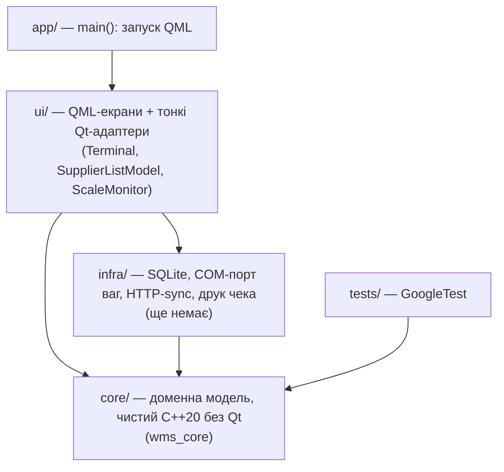

# Berry WMS Terminal

Термінал приймальника ягід (малина, полуниця, лохина) для заготівельного пункту:
**прийом → зважування → розподіл по фурах і на склад → розрахунок з постачальником**.
Працює **офлайн-першим**: кожна операція фіксується локально як незмінний запис з UUIDv7
і згодом синхронізується з сервером.

Навчальний проєкт курсу «Основи ООП» (соло) і водночас реальна задача автора —
пункт прийому ягід у Лосятині.


---

## Зміст

- [Навіщо це](#навіщо-це)
- [Можливості](#можливості)
- [Стан проєкту](#стан-проєкту)
- [Архітектура коротко](#архітектура-коротко)
- [Збірка й запуск](#збірка-й-запуск)
- [Структура репозиторію](#структура-репозиторію)
- [Документація](#документація)
- [Ключові інженерні рішення](#ключові-інженерні-рішення)
- [Дорожня карта](#дорожня-карта)
- [Зовнішні бібліотеки](#зовнішні-бібліотеки)
- [Використання ШІ](#використання-ші)

---

## Навіщо це

У сезон на пункт за день приходять десятки постачальників — від пенсіонерки з двома ящиками
до фермерського господарства з тисячею. Приймальник має:

1. зважити кожну палету (брутто − тара ящиків − палета = нетто);
2. записати ціну, що діє саме зараз (вона може змінитися посеред дня);
3. одразу завантажити палету у фуру, що стоїть під рампою, або поставити на склад;
4. розрахуватися з постачальником на місці або записати борг;
5. роздрукувати чек.

Зв'язок на пункті ненадійний, тому термінал не може залежати від сервера: усе рахується
локально, а сервер лише збирає факти з одного чи кількох терміналів.

## Можливості

### Реалізовано в ядрі (`core/`, чистий C++20, покрито тестами)

- **Чек постачальника** з кількох зважувань (палет) різних культур; нетто =
  брутто − ящики × тара ящика − палета.
- **Кілька відкритих чеків одночасно**: два великі постачальники розвантажуються по черзі,
  між ними — роздрібний; кожне зважування йде в активний чек. У постачальника — не більше
  одного відкритого чека.
- **Два режими розрахунку**: *роздріб* (ціна відома, виплата зараз або пізніше — борг у журналі)
  та *опт* (лише вага, розрахунок робить відповідальна особа поза терміналом).
- **Денні ціни** на культуру з історією змін; зважування фіксує ціну на момент прийому;
  разова ручна ціна позначається всередині, але не видна на чеку.
- **Анулювання** помилкового зважування замість видалення (слід помилки лишається).
- **Розподіл** цілою палетою або N ящиків культури (вага ділиться пропорційно, без втрати грамів
  на округленні) — у фуру або на склад, у тому числі з ще відкритого чека.
- **Склад**: залишок за культурами обчислюється з журналу; відвантаження зі складу у фуру.
- **Фури**: ліміти в ящиках та/або кг, заповненість у %, переповнення *позначається*, а не блокується
  (офлайн-конфлікт двох терміналів не губить фактів).
- **Сесія (робочий день)**: відкриття/закриття, фури сесії, «повторити фуру з учора»,
  перенесення незакритої фури в наступну сесію; закриття блокується з поясненням причин.
- **Поправки** в закритій сесії — лише з `Amendment {хто, коли, причина}` і журналом змін.
- **Журнал** append-only: баланс постачальника, завантаження фури, залишок складу — усе
  *обчислюється*, нічого не зберігається лічильником. Ідемпотентне додавання за UUID.
- **Ваги**: інтерфейс драйвера, симулятор і детектор стабільності (3 однакові покази поспіль).
- **Оператори**: вибір зі списку + PIN 4–6 цифр.

### Реалізовано в UI (`ui/`, Qt 6 / QML)

| Екран | Стан | Що вміє |
|---|---|---|
| Вхід оператора | ✅ | список операторів + PIN; без входу вкладки приховані |
| Сесія | ✅ | відкриття/закриття, ціни за культурами, фури (додати / повторити / відправити / перенести), причини, чому сесію не можна закрити |
| Прийом | ✅ | відкриті чеки, пошук постачальника (F2), табло ваг зі стабільністю, форма зважування, рядки чека, анулювання, закриття чека (роздріб/опт) |
| Розподіл | ✅ | чеки з нерозподіленим (відкриті й закриті), палетою або N ящиків — у фуру чи на склад, завантаження фур і залишок складу |
| Каса | ⏳ | заглушка |

## Стан проєкту

Альфа в розробці. Ядро закриває вимоги лабораторної 1 із запасом (19 класів, 2 ієрархії,
6+ видів поліморфізму, 169 unit-тести). Дані поки живуть у пам'яті (демо-набір постачальників,
операторів і «вчорашніх» фур); SQLite, друк чека та синхронізація — наступні етапи.

| Дата | Етап | Стан |
|---|---|---|
| 25.09.2026 | Лаба 1 — ООП-ядро | ✅ |
| 23.10.2026 | Лаба 2 — GUI, альфа | 🔄 3 з 5 екранів |
| 13.11.2026 | Лаба 3 — зовнішня бібліотека (друк чека), реліз | ⏳ |

## Архітектура коротко



Залежності йдуть **лише вниз**. Ядро не знає про Qt і тестується окремо; UI не містить
бізнес-правил — лише показує те, що повертає ядро. Детально — [docs/architecture.md](docs/architecture.md).

## Збірка й запуск

**Потрібно:** CMake ≥ 3.28, Ninja, компілятор з C++20 і `<format>` (GCC 13+ / Clang 17+),
Qt ≥ 6.8 (модулі Quick, QuickControls2). GoogleTest завантажується автоматично (потрібна мережа
при першій конфігурації).

```bash
cmake -S . -B build -G Ninja
cmake --build build
ctest --test-dir build --output-on-failure   # 169 тестів
./build/app/wms_terminal                      # термінал
```

Перевірка QML-файлів лінтером:

```bash
cmake --build build --target wms_ui_qmllint
```

Опція `-DWMS_BUILD_TESTS=OFF` вимикає збірку тестів. Збірка йде з
`-Wall -Wextra -Wpedantic -Wshadow` і має бути без попереджень.

**Демо-дані для входу:** оператори `Назарій` (PIN `1111`) і `Оксана` (PIN `2222`).
На екрані «Прийом» кнопки симулятора ставлять на ваги палету або знімають її.

## Структура репозиторію

```
core/                     доменне ядро (бібліотека wms_core, namespace wms)
  include/wms/*.h           публічні заголовки
  src/*.cpp                 реалізація
ui/                       QML-модуль BerryWms.Ui (статична бібліотека wms_ui)
  src/                      Terminal, SupplierListModel, ScaleMonitor
  qml/Main.qml              вікно, вкладки, футер
  qml/screens/*.qml         екрани
app/main.cpp              точка входу (виконуваний файл wms_terminal)
tests/*_test.cpp          unit-тести ядра (wms_core_tests)
docs/                     документація
  source/                   первинні вимоги (автора і курсу)
```

## Документація

| Документ | Про що |
|---|---|
| [docs/architecture.md](docs/architecture.md) | шари, цілі CMake, потоки даних, принципи offline-first |
| [docs/domain.md](docs/domain.md) | доменна модель: кожен клас ядра, правила, інваріанти, діаграми |
| [docs/ui.md](docs/ui.md) | екрани, міст `Terminal`, моделі, сигнали, сценарії оператора |
| [docs/development.md](docs/development.md) | збірка, тести, стиль коду, робочий процес |
| [docs/course_mapping.md](docs/course_mapping.md) | як вимоги курсу ООП відображаються в коді |
| [docs/source/](docs/source/) | первинні вимоги: бачення автора та вимоги лектора |

## Ключові інженерні рішення

- **Гроші й вага — цілі числа** (`int64` копійки / грами) у строго типізованому
  `Quantity<Tag>`: `Money + Weight` не компілюється, float-похибок немає.
- **Баланс не зберігається** — обчислюється з append-only журналу. Записи з іншого термінала
  зливаються в будь-якому порядку без втрат.
- **Записи незмінні** — помилки виправляються новим записом (анулювання, сторно), не редагуванням.
- **UUIDv7** генерує клієнт: сортуються за часом, ідемпотентність синхронізації за UUID.
- **Офлайн-конфлікти не відхиляються**: якщо два термінали переповнили фуру, обидва факти
  приймаються, переповнення показується логісту.
- **Помилки програміста vs помилки оператора**: некоректний конструктор кидає
  `std::invalid_argument`, а `validate()` повертає список зрозумілих повідомлень українською.

## Дорожня карта

1. UI: екрани «Склад» (відвантаження зі складу у фуру) і «Каса».
2. `infra/`: SQLite (WAL, бекап), відновлення відкритих чеків після перезапуску, архів сесій.
3. Друк чека: libharu (PDF) + qrcodegen (QR з UUID) або ESC/POS — лаба 3.
4. Синхронізація з мінімальним сервером-заглушкою: outbox, батчі, retry з backoff.
5. Драйвер реальних ваг через COM-порт (`SerialScaleDriver`).

Поза курсом: повноцінний бекенд (Go/FastAPI + PostgreSQL) і веб-кабінет логіста.

## Зовнішні бібліотеки

| Бібліотека | Для чого |
|---|---|
| [Qt 6](https://www.qt.io/) (Quick, QuickControls2) | інтерфейс термінала |
| [GoogleTest 1.17](https://github.com/google/googletest) | unit-тести (завантажується CMake автоматично) |

Заплановано для лаби 3: [libharu](https://github.com/libharu/libharu) (PDF),
[nayuki QR-Code-generator](https://github.com/nayuki/QR-Code-generator) (QR).

## Використання ШІ

Під час розробки використовується Claude Code (Anthropic) як асистент.
Історія запитів зберігається; весь код переглядається й розуміється автором.
Робочі домовленості з асистентом — у [`CLAUDE.md`](CLAUDE.md).
