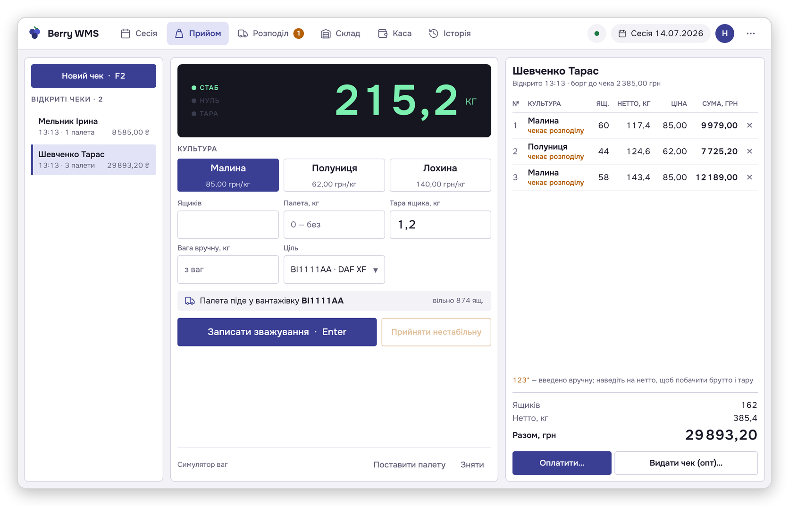
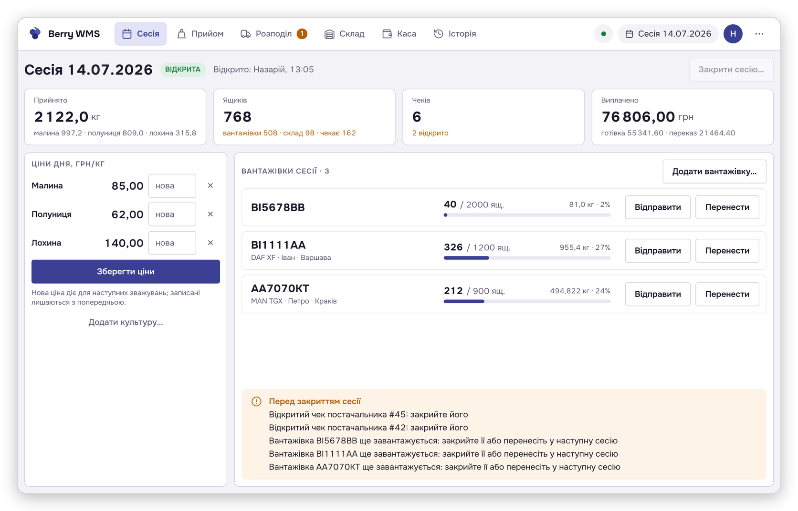
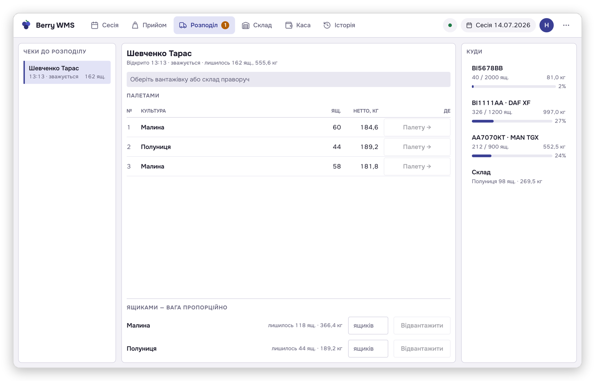
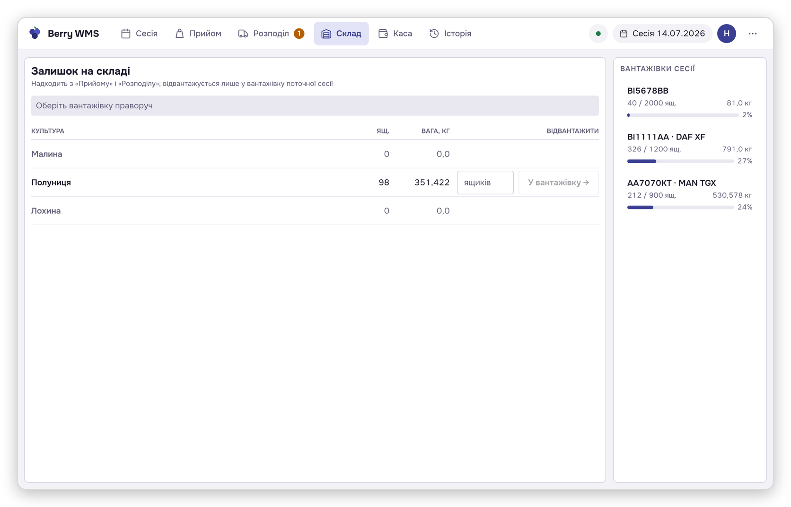
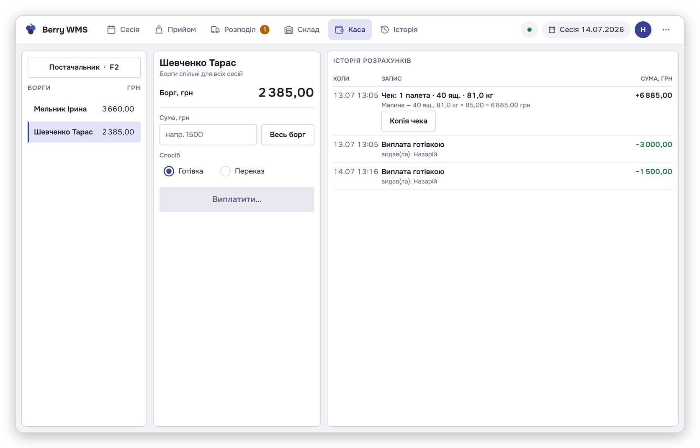
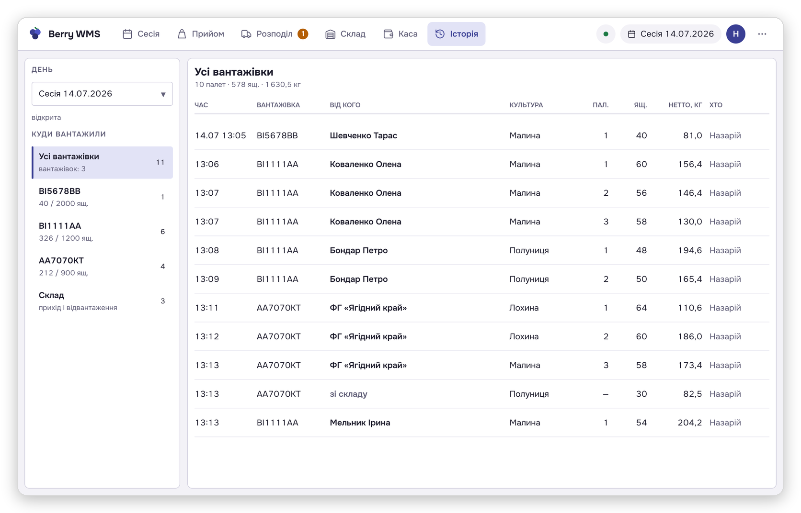
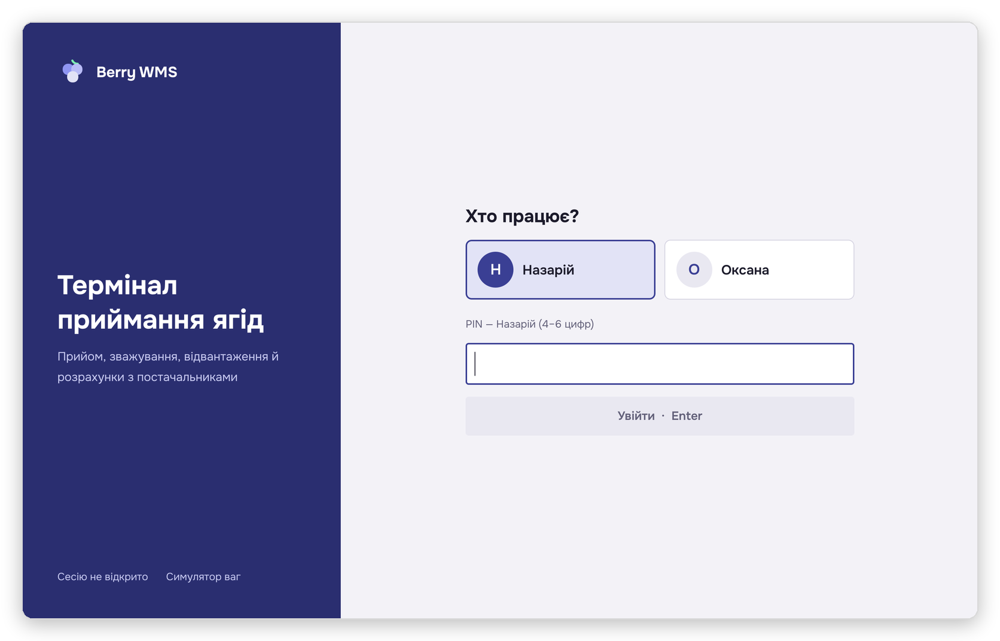
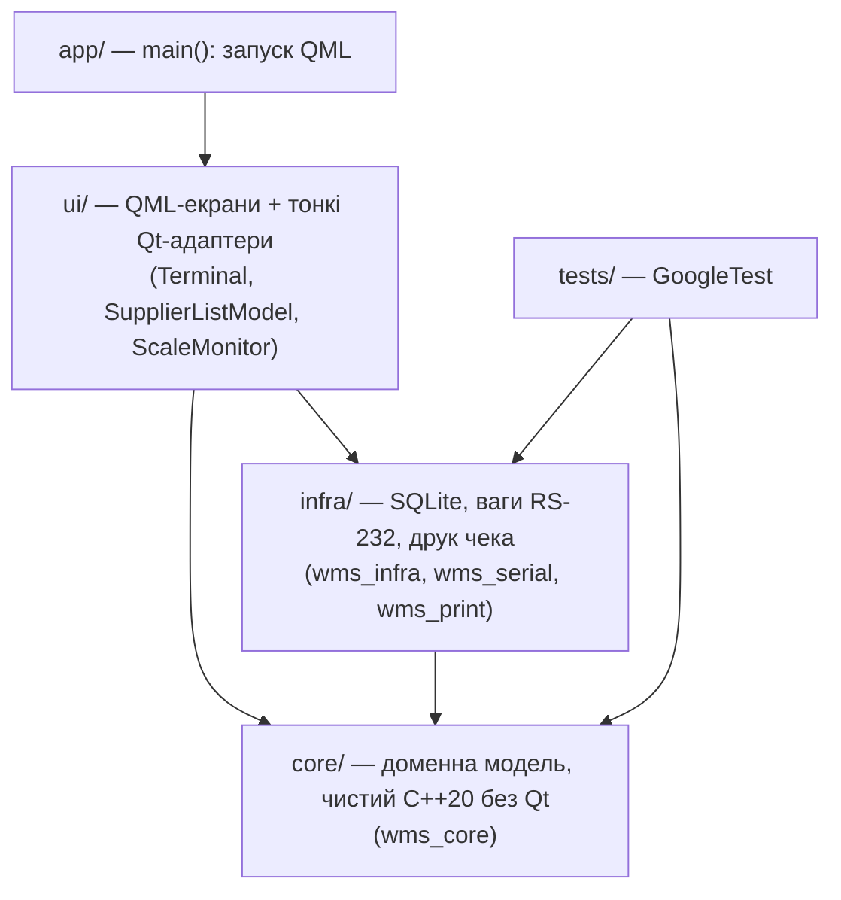

<div align="center">

# 🫐 Berry WMS Terminal

**Робоче місце приймальника на заготівельному пункті ягід**<br>
зважування палет · розподіл по фурах і на склад · розрахунок із постачальниками · друк чека


<picture>
  <source media="(prefers-color-scheme: dark)" srcset="docs/screenshots/receiving-dark.png">
  
</picture>

</div>

Термінал працює **без інтернету**: кожна операція одразу записується в локальну базу, а сервер лише збирає
факти, коли з'являється зв'язок. Робиться для реального пункту прийому малини, полуниці й лохини.

- **Ваги.** Справжні промислові ваги ІЕ-04 по RS-232 або вбудований симулятор.
- **Кілька чеків одночасно.** Великі постачальники розвантажуються по черзі, а між ними проходить роздрібний.
- **Авторозподіл.** Палета одразу йде у фуру під рампою. Якщо місця немає, вона чекає ручного розподілу.
- **Чесні гроші.** Баланс рахується з незмінного журналу. Помилки виправляються сторно-записом, а не редагуванням.
- **Друк чека з QR-кодом** на звичайному принтері: A4 або A5.

## Зміст

- [Як це виглядає](#як-це-виглядає)
- [Навіщо це](#навіщо-це)
- [Можливості](#можливості)
- [Швидкий старт](#швидкий-старт)
- [Архітектура](#архітектура)
- [Ключові інженерні рішення](#ключові-інженерні-рішення)
- [Стан і дорожня карта](#стан-і-дорожня-карта)
- [Документація](#документація)
- [Структура репозиторію](#структура-репозиторію)
- [Зовнішні бібліотеки](#зовнішні-бібліотеки)
- [Походження проєкту](#походження-проєкту)
- [Використання ШІ](#використання-ші)

## Як це виглядає

Шість робочих вкладок за ходом дня (клавіші F5–F10), світла й темна теми (README показує ту, що у вашому GitHub).
Знімки зроблено при 1280×800, тобто Full HD при масштабі 150%, на демо-даних. Натисніть на знімок, щоб збільшити.

<table>
<tr>
<td width="50%" valign="top">
<picture>
  <source media="(prefers-color-scheme: dark)" srcset="docs/screenshots/session-dark.png">
  
</picture>
<b>Сесія</b>: зведення дня (прийнято, де ящики, чеки, виплати), ціни дня, фури із заповненням і що лишилося
зробити перед закриттям.
</td>
<td width="50%" valign="top">
<picture>
  <source media="(prefers-color-scheme: dark)" srcset="docs/screenshots/allocation-dark.png">
  
</picture>
<b>Розподіл</b>: палети, яким не вистачило місця. Цілою палетою або N ящиків, у фуру чи на склад.
</td>
</tr>
<tr>
<td width="50%" valign="top">
<picture>
  <source media="(prefers-color-scheme: dark)" srcset="docs/screenshots/warehouse-dark.png">
  
</picture>
<b>Склад</b>: залишок за культурами, що переживає сесії; відвантаження у фуру.
</td>
<td width="50%" valign="top">
<picture>
  <source media="(prefers-color-scheme: dark)" srcset="docs/screenshots/cash-dark.png">
  
</picture>
<b>Каса</b>: борги постачальників, виплата готівкою чи переказом, історія чеків і виплат, копія чека.
</td>
</tr>
<tr>
<td width="50%" valign="top">
<picture>
  <source media="(prefers-color-scheme: dark)" srcset="docs/screenshots/history-dark.png">
  
</picture>
<b>Історія</b>: що завантажено в кожну фуру й на склад, від кого і хто вантажив, за будь-який день з архіву.
</td>
<td width="50%" valign="top">
<picture>
  <source media="(prefers-color-scheme: dark)" srcset="docs/screenshots/login-dark.png">
  
</picture>
<b>Вхід</b>: оператор і PIN, тож кожен запис знає, хто його зробив.
</td>
</tr>
</table>

## Навіщо це

У сезон на пункт за день приходять десятки постачальників, від пенсіонерки з двома ящиками до фермерського
господарства з тисячею. Приймальник має:

1. зважити кожну палету (брутто − тара ящиків − палета = нетто);
2. записати ціну, що діє саме зараз (вона може змінитися посеред дня);
3. одразу завантажити палету у фуру, що стоїть під рампою, або поставити на склад;
4. розрахуватися з постачальником на місці або записати борг;
5. роздрукувати чек.

Зв'язок на пункті ненадійний, тому термінал не може залежати від сервера. Усе рахується локально, а сервер лише
збирає факти з одного чи кількох терміналів.

## Можливості

<details open>
<summary><b>Прийом і чеки</b></summary>

- **Чек постачальника** з кількох зважувань (палет) різних культур. Нетто = брутто − ящики × тара ящика − палета.
- **Кілька відкритих чеків одночасно**; кожне зважування йде в активний чек. У постачальника не більше одного
  відкритого чека. Відкриті чеки переживають перезапуск.
- **Дві дії закриття.** «Оплатити» (роздріб): одна ціна грн/кг на культуру в чеку, уся сума виплачується одразу.
  «Видати чек» (опт): лише вага, ціну визначає відповідальна особа поза терміналом.
- **Денні ціни** на культуру з історією змін. Під час оплати ціну можна змінити для всієї культури в чеку.
- **Анулювання** помилкового зважування замість видалення, тож слід помилки лишається.
- **Ваги:** ВН-2000-4 з індикатором ІЕ-04 по RS-232 (стабільність береться з біта індикатора) або симулятор.
  Нестабільну вагу оператор може прийняти окремою кнопкою, вага, введена вручну, позначається.
- **Друк чека** після запису в базу: QR-код з UUID чека, опт без цін, позначка копії, PDF замість паперу для перевірок.

</details>

<details open>
<summary><b>Фури, склад і розподіл</b></summary>

- **Розподіл** цілою палетою або N ящиків культури (вага ділиться пропорційно, без втрати грамів на округленні),
  у фуру чи на склад, навіть з ще відкритого чека.
- **Авторозподіл:** палета йде туди, куди пішла попередня палета цієї культури в чеку, інакше в обрану ціль.
  Якщо місця немає, палета «підвішена». Анулювання знімає розподіл **сторно-записом**.
- **Фури:** ліміт у ящиках (кг лише довідково). Переповнення *позначається*, а не блокується, тож офлайн-конфлікт
  двох терміналів не губить фактів.
- **Склад:** залишок за культурами обчислюється з журналу; відвантаження зі складу йде у фуру поточної сесії.
- **Історія вантаження:** від кого, яка палета чека і хто вантажив; зняті сторно лишаються видимими.

</details>

<details open>
<summary><b>Робочий день і гроші</b></summary>

- **Сесія (робочий день):** відкриття й закриття, «повторити фуру з учора», перенесення незакритої фури в
  наступну сесію. Якщо сесію не можна закрити, термінал пояснює чому.
- **Поправки** в закритій сесії лише з `Amendment {хто, коли, причина}`.
- **Каса:** борги, аванси (переплату дозволено з попередженням), виплата готівкою чи переказом.
- **Журнал** append-only: баланс постачальника, завантаження фури й залишок складу *обчислюються*, а не
  зберігаються лічильником.
- **Оператори:** вибір зі списку + PIN. Кожна виплата, розподіл, сторно й відвантаження знає, хто це зробив.
- **Довідники:** культури додаються протягом сезону (дублі «Малина» / «малина » блокуються), новий постачальник
  додається прямо з пошуку.

</details>

<details>
<summary><b>Інтерфейс</b></summary>

- Панель над екранами: вкладки з іконками й клавішами F5–F10, стан ваг і сесії, оператор.
- Меню ⋯: порт ваг, масштаб (100–175%, свій на кожен термінал), папір чека (A4/A5), типова тара ящика,
  повноекранний режим (F11), тема, вихід.
- Власний стиль Qt Quick Controls і дизайн-токени (`Theme`), шрифт Onest із табличними цифрами.
- Порожні стани пояснюють, що з'явиться на панелі, і пропонують наступний крок.
- Мінімальне вікно 1024×600, бо цільові пристрої — ноутбуки.

</details>

## Швидкий старт

**Потрібно:** CMake ≥ 3.28, Ninja, компілятор C++20 з `<format>` (GCC 13+ / Clang 17+), Qt ≥ 6.8 (Quick,
QuickControls2, SerialPort, PrintSupport, плагін SVG; переклади Qt — необов'язково). GoogleTest, SQLite і
qrcodegen завантажуються автоматично, тож під час першої конфігурації потрібна мережа. Пакети для Ubuntu
наведено в [docs/development.md](docs/development.md#1-оточення).

```bash
cmake -S . -B build -G Ninja
cmake --build build
ctest --test-dir build --output-on-failure   # 356 тестів
./build/app/wms_terminal
```

**Демо-вхід:** `Назарій` (PIN `1111`) або `Оксана` (PIN `2222`). Нова база отримує демо-сесію «вчора» і трохи історії.

| Що | Як |
|---|---|
| База | `~/.local/share/BerryWms/Berry WMS Terminal/terminal.db`; бекапи поруч у `backups/` (при запуску й закритті сесії, 30 останніх) |
| Запуск без сліду | `WMS_DATABASE=:memory:` |
| Справжні ваги | меню ⋯ «Ваги…» або `WMS_SCALE_PORT=<порт>`; без них працює симулятор (кнопки на «Прийомі») |
| Чеки в PDF замість паперу | `WMS_PRINT_PDF=<тека>` |
| Лінтер QML | `cmake --build build --target wms_ui_qmllint` |
| Знімки екранів | `tools/shots/shots.sh` (перевірка «до/після»), `tools/shots/readme.sh` (знімки для README) |

Збірка йде з `-Wall -Wextra -Wpedantic -Wshadow` і має бути без попереджень. `-DWMS_BUILD_TESTS=OFF` вимикає тести.

**Встановлення:** `packaging/build-packages.sh` збирає `.deb` (Ubuntu 26.04+) або `.rpm` (Fedora 42+) з ярликом, іконкою
і правилом udev для кабелю ваг; далі `sudo apt install ./build-release/berry-wms_*.deb` чи `sudo dnf install ./build-release/berry-wms-*.rpm`,
запуск — `berry-wms` або з меню. Деталі — [docs/development.md](docs/development.md#встановлення-й-пакети).

## Архітектура



Залежності йдуть **лише вниз**. Ядро не знає про Qt і тестується окремо. UI не містить бізнес-правил, а лише
показує те, що повертає ядро. Детально описано в [docs/architecture.md](docs/architecture.md).

## Ключові інженерні рішення

- **Гроші й вага — цілі числа** (`int64` копійки / грами) у строго типізованому `Quantity<Tag>`: `Money + Weight`
  не компілюється, float-похибок немає.
- **Баланс не зберігається:** він обчислюється з append-only журналу. Записи з іншого термінала зливаються в
  будь-якому порядку без втрат.
- **Записи незмінні:** помилки виправляються новим записом (анулювання, сторно), а не редагуванням.
- **UUIDv7 генерує клієнт:** ідентифікатори сортуються за часом, синхронізація ідемпотентна за UUID.
- **Офлайн-конфлікти не відхиляються:** якщо два термінали переповнили фуру, обидва факти приймаються, а
  переповнення бачить логіст.
- **Помилки програміста й помилки оператора розділено:** некоректний конструктор кидає `std::invalid_argument`,
  а `validate()` повертає зрозумілі повідомлення українською.

## Стан і дорожня карта

**Бета.** Увесь робочий цикл пункту працює на одному терміналі: журнал, сесії, відкриті чеки й довідники лежать у
локальній SQLite з бекапом, друк чека й драйвер справжніх ваг готові.

- [x] Шість екранів, власний стиль, світла й темна теми
- [x] Локальна SQLite: журнал, сесії з архівом, довідники, міграції схеми, бекап
- [x] Авторозподіл, «Оплатити» / «Видати чек», довідник культур, ліміт фури в ящиках
- [x] Драйвер ваг ВН-2000-4 / ІЕ-04 по RS-232 ([docs/hardware/scale-ie04.md](docs/hardware/scale-ie04.md))
- [x] Друк чека з QR-кодом на звичайному принтері
- [x] Історія вантаження: по кожній фурі, по всіх фурах і по складу
- [x] Рефакторинг UI на спільні QML-компоненти
- [ ] Розгортання: `.deb`/`.rpm` (у роботі), AppImage, готові пакети на сторінці релізів
- [ ] Гнучкіше перевантаження й довантаження фур
- [ ] Доплата постачальникам, якщо ціна сильно піднялася (окремим записом журналу, чеки незмінні)
- [ ] Синхронізація терміналів точки через мінімальний сервер: outbox, батчі, retry з backoff
- [ ] Звіти

Далі: повноцінний бекенд (Go/FastAPI + PostgreSQL), веб-кабінет логіста, захист чека від підробки підписом у QR
(Ed25519, див. [docs/architecture.md](docs/architecture.md)).

## Документація

| Документ | Про що |
|---|---|
| [docs/architecture.md](docs/architecture.md) | шари, цілі CMake, потоки даних, принципи offline-first |
| [docs/domain.md](docs/domain.md) | доменна модель: кожен клас ядра, правила, інваріанти, діаграми |
| [docs/ui.md](docs/ui.md) | екрани, спільні компоненти, міст `Terminal`, сигнали, сценарії оператора |
| [docs/development.md](docs/development.md) | оточення, збірка, тести, знімки екранів, стиль коду, робочий процес |
| [docs/hardware/scale-ie04.md](docs/hardware/scale-ie04.md) | ваги ВН-2000-4 / ІЕ-04: кабель, налаштування, протокол RS-232 |
| [docs/ui_qml_vs_widgets.md](docs/ui_qml_vs_widgets.md) | експеримент: «Історія» на Qt Widgets проти QML, чому UI лишився на QML |
| [docs/course/](docs/course/) | навчальний курс, з якого почався проєкт: лаби, відповідність вимогам, звіт |
| [docs/source/](docs/source/) | первинні вимоги: бачення автора та вимоги курсу |

## Структура репозиторію

```
core/                 доменне ядро: wms_core, namespace wms (include/wms/*.h, src/*.cpp)
infra/                wms_infra — SQLite, схема з версіями, сховища, бекап;
                      wms_serial — ваги ІЕ-04; wms_print — QR і друк чека
ui/                   QML-модуль BerryWms.Ui (wms_ui)
  src/                  Terminal, SupplierListModel, ScaleMonitor, display_format
  qml/                  Main.qml, AppBar.qml, screens/ — екрани й спільні компоненти
  style/                модуль BerryWms.Style: власний стиль контролів, Theme.qml, шрифт Onest, іконки
app/main.cpp          точка входу (wms_terminal)
packaging/            встановлення й пакети: ярлик, іконка, правило udev, CPack, build-packages.sh
tests/                unit-тести: wms_core_tests, wms_infra_tests, wms_serial_tests, wms_print_tests
tools/shots/          wms_shots — знімки екранів без вікна
docs/                 документація; screenshots/ — знімки для README
```

## Зовнішні бібліотеки

| Бібліотека | Для чого |
|---|---|
| [Qt 6](https://www.qt.io/) (Quick, QuickControls2, Svg, SerialPort, PrintSupport) | інтерфейс, порт ваг, друк чека |
| [SQLite 3.51](https://sqlite.org/) | локальна база термінала (офіційна амальгамація, завантажується CMake) |
| [nayuki QR-Code-generator 1.8.0](https://github.com/nayuki/QR-Code-generator) (MIT) | QR-код з UUID чека: версія, корекція Ріда — Соломона, маска (завантажується CMake) |
| [GoogleTest 1.17](https://github.com/google/googletest) | unit-тести (завантажується CMake) |
| [Onest](https://fonts.google.com/specimen/Onest) (OFL 1.1) | шрифт інтерфейсу, вбудований у ресурси |
| [Lucide](https://lucide.dev) (ISC) | контури іконок панелі (`ui/style/icons/`) |

## Походження проєкту

Це особистий проєкт автора для реального пункту прийому. Восени 2026 року він водночас був соло-проєктом
навчального курсу «Основи ООП» (три лабораторні й реліз, усе здано). Етапи, відповідність вимогам і звіт зібрано
в [docs/course/](docs/course/).

## Використання ШІ

Під час розробки як асистент використовується Claude Code (Anthropic). Історія запитів зберігається, а весь код
автор переглядає й розуміє. Робочі домовленості з асистентом записано в [`CLAUDE.md`](CLAUDE.md).
