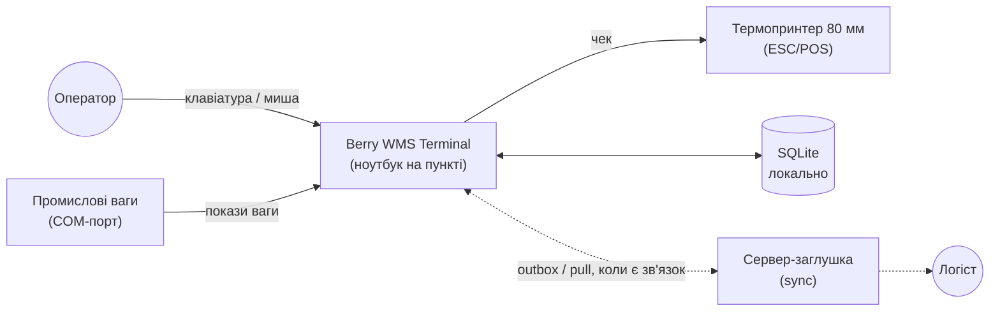
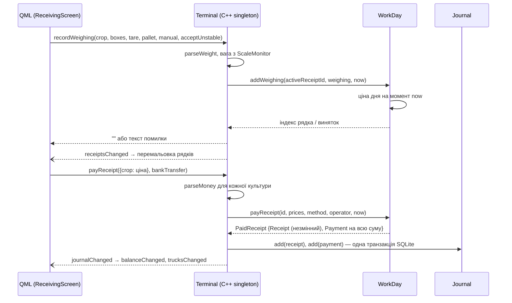

# Архітектура

Документ описує, як влаштований термінал: шари, цілі збірки, як дані проходять від
екрана до ядра і чому все побудовано навколо append-only журналу.

## 1. Контекст



На пункті працює 1–2 термінали, але архітектура не повинна ламатися при N: кожен термінал
самостійний, а сервер лише зводить факти. Суцільні лінії вже існують (крім ваг і принтера —
лише симулятор), пунктир — заплановано.

## 2. Шари

| Шар | Каталог | Ціль CMake | Залежить від | Що містить |
|---|---|---|---|---|
| Ядро | `core/` | `wms_core` (статична бібліотека) | лише стандартна бібліотека C++20 | доменні класи, правила, валідація, обчислення |
| Інфраструктура | `infra/` | `wms_infra` + `sqlite3` (амальгамація) | core; Qt — лише для пристроїв | обгортка SQLite (`sqlite::Database`/`Statement`/`ScopedTransaction`) ✅; схема з версіями (`migrateSchema`, 8 міграцій) + `SqliteJournalStore` + `SqliteSessionStore` + `SqliteRepository<T>` + `backupDatabase` ✅; COM-порт ваг, HTTP-sync, друк — далі |
| Інтерфейс | `ui/` | `wms_ui` + `wms_uiplugin` (QML-модуль `BerryWms.Ui`) | core, Qt Quick | QML-екрани і тонкі адаптери |
| Точка входу | `app/` | `wms_terminal` (виконуваний) | ui | `main()`: створює `QGuiApplication`, завантажує `Main.qml` |
| Тести | `tests/` | `wms_core_tests`, `wms_infra_tests` | core / infra, GoogleTest | 235 тестів ядра + 36 тестів infra на справжній SQLite |

**Правило залежностей:** лише вниз (`app → ui → infra → core`). Ядро не підключає жодного
заголовка Qt — це перевіряється тим, що `wms_core` лінкується без Qt і тестується окремо.

### Чому ядро без Qt

- Доменні правила (розрахунок нетто, баланс, заповненість фури) — найцінніша і найризиковіша
  частина. Вони тестуються швидко й без GUI.
- Той самий код стане в пригоді на сервері чи в іншому клієнті.
- UI можна переписати, не зачепивши жодного правила.

### Чому UI «тонкий»

QML лише показує властивості й викликає методи синглтона `Terminal`. Жодного `if` з бізнес-правилом
у QML немає: наприклад, чому не можна закрити сесію, екран дізнається з
`WorkDay::validateClose()` через властивість `Terminal.closeBlockers` і просто показує список.

## 3. Цілі збірки

```mermaid
flowchart BT
    core[wms_core]
    ui[wms_ui]
    plugin[wms_uiplugin]
    term[wms_terminal]
    infra[wms_infra]
    sqlite[sqlite3]
    style[wms_style]
    tests[wms_core_tests]
    itests[wms_infra_tests]
    gtest[GTest::gtest_main]
    qt[Qt6::Quick / QuickControls2]

    infra --> core
    infra --> sqlite
    ui --> core
    ui --> infra
    ui --> style
    ui --> qt
    style --> qt
    plugin --> ui
    term --> ui
    term --> plugin
    tests --> core
    tests --> gtest
    itests --> infra
    itests --> gtest
```

- `wms_ui` — статична бібліотека, тому QML-плагін імпортується явно:
  `Q_IMPORT_QML_PLUGIN(BerryWms_UiPlugin)` у `app/main.cpp`.
- QML-модулі збираються в `build/qml/<URI>` (`QT_QML_OUTPUT_DIRECTORY`), де їх знаходять і
  рушій, і `qmllint`. Ціль `wms_ui_qmllint` перевіряє всі QML-файли.
- Якщо QML не вдалося створити, `main()` завершує процес з кодом 1 — щоб не лишався невидимий
  процес без вікна.

## 4. Модель даних: журнал фактів

Центральна ідея — **append-only журнал** (`wms::Journal`). Усе, що сталося на пункті, — це
незмінний факт (`Transaction`) з UUIDv7:

| Факт | Клас | Вплив на борг постачальнику |
|---|---|---|
| Прийнято ягоду | `Receipt` | + сума чека (роздріб), 0 (опт) |
| Виплачено гроші | `Payment` | − сума |
| Частину чека покладено у фуру / на склад | `Allocation` | 0 |
| Розподіл скасовано (сторно) | `AllocationReversal` | 0 |
| Зі складу відвантажено у фуру | `StockShipment` | 0 |

Похідні величини **ніколи не зберігаються**, а обчислюються з журналу:

```
balanceOf(supplier) = Σ receipt.amount − Σ payment.amount
loadOf(truck)       = Σ allocation(→truck).cargo + Σ shipment(→truck).cargo
stockOf(crop)       = Σ allocation(→склад).cargo − Σ shipment(crop).cargo
unallocatedOf(r, c) = receipt.cargoOf(c) − Σ allocation(r, c).cargo
```

Чому так:

1. **Злиття без конфліктів.** Два офлайн-термінали можуть завантажувати одну фуру. Якби
   `Truck` тримав лічильник, при синхронізації один лічильник перезаписав би інший. Факти ж
   просто об'єднуються як множини.
2. **Ідемпотентність.** `Journal::add` повертає `false`, якщо запис з таким UUID уже є — повторна
   доставка при sync нешкідлива.
3. **Аудит.** Видно, звідки взялася кожна гривня боргу; помилки виправляються новим записом.

### Що не є записом журналу

Деякі об'єкти змінюються впродовж роботи, тому живуть окремо від журналу:

- `OpenReceipt` — чек, що ще зважується. При закритті перетворюється на незмінний `Receipt`
  з **тим самим UUID** (id видається при відкритті, бо палети можуть піти у фуру ще до закриття).
- `WorkDay` — сесія: денні ціни (`DayPrices`), фури сесії, відкриті чеки, поправки.
- `Truck` — статус фури (`Loading` / `Departed` / `CarriedOver`) і ліміт у ящиках; завантаження — з журналу.

## 5. Валідація: два рівні помилок

| Хто помилився | Як сигналізується | Приклад |
|---|---|---|
| Програміст (порушено контракт) | виняток: `std::invalid_argument`, `std::logic_error`, `std::out_of_range` | `Truck` без номера; `close()` сесії, коли `validateClose()` не порожній |
| Оператор (неповні / хибні дані) | `validate()` / `validateXxx()` повертає `std::vector<std::string>` українською | «Ціна за кг має бути більшою за нуль», «Залишилось лише 12 ящ. культури raspberry» |

Схема використання в UI завжди однакова: спершу `validate…()` → показати причини →
лише якщо список порожній, викликати дію, яка інакше кинула б виняток.

**Навмисний виняток:** `Journal::add()` *не* викликає `validateAllocation()`. Факти, що прийшли
з іншого термінала, приймаються як є (навіть якщо фура переповнена) — переповнення показується,
а не відхиляється.

## 6. Потік даних у UI



Методи `Terminal`, які може зламати ввід оператора, повертають `QString` з помилкою
(порожній — успіх), тож QML не має обробляти винятки.

## 7. Час і дата

- Ядро працює з `std::chrono::system_clock::time_point` (UTC).
- Локальна дата сесії передається в `WorkDay` ззовні (`year_month_day`): ядро не знає часового
  поясу, а UI знає (`QDate::currentDate()`).
- Ціна, що діє на момент зважування, визначається **за часом**, а не за порядком запису
  (`DayPrices::priceAt`), бо зміни цін можуть прийти пізніше через sync.

## 8. Що буде далі в архітектурі

- **`infra/` + SQLite** (`journal_mode=WAL`, бекап — див. нижче). Етап закрито. Доступ — прямий C API
  `sqlite3` (амальгамація через `FetchContent`, без Qt Sql): сховища тестуються без `QCoreApplication`,
  а RAII-обгортка перетворює коди помилок на винятки `sqlite::Error`. `ScopedTransaction` побудовано на
  `SAVEPOINT`, тож транзакції вкладаються: сховище пише у своїй, а запис у два сховища (закриття чека =
  чек у журнал + знімок сесії) обгортається зовнішньою — вона й вирішує, чи лишиться все разом. Обгортка навмисно не вміє
  прив'язувати `double` — гроші й вага лише цілими.
  - ✅ Схема: `migrateSchema` веде версію в `PRAGMA user_version` — список кроків лише доповнюється,
    кожен крок і новий номер версії комітяться разом; база новішої версії відхиляється. Таблиці
    `STRICT`; id — UUID текстом; час — наносекунди від епохи Unix (`createdAt` повертається точно);
    гроші `_kop`, вага `_g`; переліки — текстом з `CHECK` (перестановка `enum` у C++ не змінить старі рядки).
  - ✅ Журнал: інтерфейс `JournalStore` у core (`save(Receipt|Payment|Allocation|AllocationReversal|StockShipment)`, `load()`),
    реалізація `SqliteJournalStore`: таблиці `receipt` + `weighing` (рядки з номером `line` — на нього
    посилаються розподіли), `payment`, `allocation` (`truck_id` NULL = склад; без зовнішнього ключа на `receipt`,
    бо палета відкритого чека йде у фуру раніше, ніж чек записано), `stock_shipment`; усі з `sync_status`.
    Повторне збереження того самого UUID — `false` (`ON CONFLICT DO NOTHING RETURNING`).
  - ✅ Сесії: інтерфейс `SessionStore` у core (`save(WorkDay)`, `current()`, `lastClosed()`), реалізація `SqliteSessionStore`
    (міграція 2). Сесія — змінний стан, тому зберігається **знімком**: `save` у транзакції перезаписує
    її списки (`price_change`, `truck`, `amendment`, `open_receipt` + `open_weighing`) — десятки рядків,
    простіше й надійніше, ніж шукати різницю. Закриті сесії лишаються в базі (архів). `current()` — відкрита
    сесія (продовжуємо після перезапуску); `lastClosed()` — остання закрита (її фури для «повторити»/«перенести»;
    «повторити» доступне й під час відкритої сесії, тому окремий запит).
    Відновлення — `WorkDay::restore(WorkDayRecord)`, `Truck` зі статусом. Зважування й назви переліків
    спільні для обох сховищ — внутрішній `infra/src/rows.h`.
  - ✅ Підключено до `Terminal` (база в теці даних програми, `WMS_DATABASE` перевизначає; демо-дані лише в нову базу).
  - ✅ Довідники: шаблонний інтерфейс `Repository<T>` у core (`save` — додати або замінити за id, `all()` — за id),
    реалізація `SqliteRepository<T>` (міграція 3: таблиці `supplier`, `operator`). Різниця між типами — лише
    таблиця й колонки: приватна спеціалізація `Table<Supplier>` / `Table<Operator>` / `Table<Crop>` у `.cpp`, шаблон явно
    інстанційований для цих типів (`template class ...`), тож інший тип не злінкується.
    Довідники належать серверу, тому `save` — upsert (`ON CONFLICT DO UPDATE`), а не append, як у журналі.
  - ✅ Культури: міграція 5 — таблиця `crop` (`code TEXT PRIMARY KEY`, `name`), `Table<Crop>`; порядок — `rowid`
    (порядок додавання; upsert зберігає `rowid`, тож перейменована культура лишається на своєму місці).
    Міграція 6 — `archived` (`DEFAULT 0`: на відміну від `paid_by`, нуль правильний для всіх рядків);
    `Repository<T>::remove` — `DELETE` за ключем (`Table<T>::deleteOne`).
  - ✅ Ліміт фури лише в ящиках: міграція 7 перебудовує `truck` без `limit_g`, з `CHECK (limit_boxes > 0)`.
    Фури з лімітом лише в кг (тільки тестові бази альфи) отримують грубо 2 кг на ящик.
  - ✅ Сторно розподілу: міграція 8 — таблиця `allocation_reversal` (`allocation_id` без зовнішнього ключа:
    sync може привезти сторно раніше за розподіл).
  - ✅ Оператор у `Payment` (`paidBy`): міграція 4 перебудовує таблицю `payment` з колонкою `paid_by NOT NULL`
    (SQLite не додає `NOT NULL`-колонку без `DEFAULT`, а `DEFAULT` мовчки підставляв би оператора в майбутні
    `INSERT`, що його забули). Старі виплати (лише тестові бази альфи) приписано оператору 1, порядок рядків збережено.
  - ✅ Бекап: `sqlite::Database::backupTo` (`VACUUM INTO` — цілісна копія навіть у WAL) + `backupDatabase(db, folder, at, keep)`
    (назва з часом UTC → сортування за назвою = за часом; ротація чіпає лише свої файли). `Terminal` — при запуску й закритті сесії.
- **Sync**: outbox незасинхронізованих записів, батчі, сервер повертає прийняті UUID
  (`Transaction::markSynced()`), retry з backoff; pull довідників за курсором `updated_since`.
- **`SerialScaleDriver`** — реалізація `IScaleDriver` через Qt SerialPort; `ScaleMonitor`
  знає драйвер лише через інтерфейс, тож заміна симулятора не зачепить UI.
- **Друк чека** (лаба 3, без Qt-друку): термопринтер 80 мм, команди ESC/POS; QR з UUID чека — nayuki qrcodegen
  або вбудований QR принтера. Модель принтера ще не обрана.
