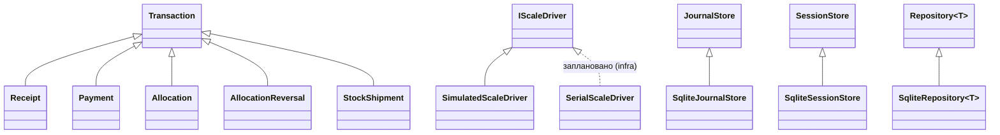

# Відповідність вимогам курсу ООП

Як вимоги лектора ([docs/source/course_requirements.md](source/course_requirements.md))
виконуються в коді. Документ оновлюється по ходу роботи.

## Загальні вимоги

| Вимога | Як виконано |
|---|---|
| Сучасна ООП-мова | C++20 (concepts, `std::variant`, `<=>`, `std::format`, designated initializers, ranges) |
| Одна програма, одна точка входу `main()` | `app/main.cpp` → `wms_terminal` |
| Git з регулярними змістовними комітами | малі кроки, кожен — окремий коміт; `git log` |
| Unit-тести (для «відмінно») | 200 тестів GoogleTest у `tests/` (176 ядра + 24 infra на справжній SQLite), ядро пишеться тест-першим |
| Декларація використання ШІ | розділ у [README](../README.md#використання-ші), домовленості в `CLAUDE.md` |
| Аналіз конкурентів (для «відмінно») | ⏳ `docs/competitors.md` |

## Лабораторна 1 — базові ідеї ООП ✅

| Вимога | Мінімум | Є |
|---|---|---|
| Класи / типи | 9 | 19 класів ядра + допоміжні структури (`Weighing`, `Cargo`, `TruckDetails`, `PriceChange`, `Amendment`, `AmendmentRecord`, `ToWarehouse`) |
| Поля | 15 | значно більше (напр., лише `Weighing` — 9, `WorkDay` — 9, `Truck` — 5) |
| Нетривіальні методи | 25 | значно більше (див. нижче) |
| Ієрархії успадкування | 2, одна ≥ 3 класи | A: `Transaction` → 4 класи; B: `IScaleDriver` → `SimulatedScaleDriver`; C: `JournalStore` → `SqliteJournalStore`, D: `SessionStore` → `SqliteSessionStore`, E: `Repository<T>` → `SqliteRepository<T>` (infra) |
| Поліморфізм | 3, ≥1 статичний, ≥1 динамічний | 7 випадків (таблиця нижче) |
| Інкапсуляція | доцільні рівні доступу | див. нижче |

### Класи ядра

`Quantity<Tag>` (`Money`, `Weight`), `Uuid`, `Supplier`, `Operator`, `Crop`, `CropKeys`, `Transaction`, `Receipt`,
`Payment`, `Allocation`, `AllocationReversal`, `StockShipment`, `OpenReceipt`, `Truck`, `Journal`, `DayPrices`, `WorkDay`,
`IScaleDriver`, `SimulatedScaleDriver`, `StabilityDetector`, `JournalStore`, `SessionStore`, `Repository<T>` + infra-класи
`sqlite::Database`, `sqlite::Statement`, `sqlite::ScopedTransaction`, `sqlite::Error`, `SqliteJournalStore`, `SqliteSessionStore`, `SqliteRepository<T>` + UI-класи `Terminal`, `SupplierListModel`,
`ScaleMonitor`. Детально — [domain.md](domain.md).

### Ієрархії

### Поліморфізм

| # | Вид | Де |
|---|---|---|
| 1 | Динамічний (віртуальні методи) | `Transaction::kind/balanceEffect/validate/describe` у 5 нащадках; `Journal::historyOf` віддає `const Transaction*` — Каса показує чеки й виплати через `describe()`/`balanceEffect()` |
| 2 | Динамічний (інтерфейс) | `IScaleDriver` — `ScaleMonitor` працює з будь-яким драйвером; `JournalStore`/`SessionStore` — ядро не знає, що дані лежать у SQLite |
| 3 | Статичний (шаблон з тегом) | `Quantity<Tag>`: `Money` і `Weight` — різні типи |
| 4 | Статичний (`std::variant` + `std::visit`) | `Destination = variant<TruckId, ToWarehouse>` в `Allocation::describe`, `Journal::loadOf/stockOf` |
| 5 | Статичний (перевантаження) | `Journal::add(Receipt / Payment / Allocation / AllocationReversal / StockShipment)`; `unallocatedOf`, `boxesOf`, `validateAllocation` для `Receipt` і `OpenReceipt`; `WorkDay::setPrice/addTruck/…` з `Amendment` і без |
| 6 | Статичний (concept) | `WeighedReceipt` — шаблонні `Allocation::wholeWeighing/boxesOf`, `Journal::checkAllocation` приймають `Receipt` і `OpenReceipt` |
| 7 | Статичний (шаблон класу) + динамічний | `Repository<T>`: один інтерфейс довідника для `Supplier`, `Operator` і `Crop`; `SqliteRepository<T>` бере таблицю й колонки зі спеціалізації `Table<T>` |

### Приклади нетривіальних методів

`Weighing::net/amount/validate`, `Receipt::total/cargoOf/amount/validate/describe`,
`OpenReceipt::add/cancel/validateClose/close`, `Allocation::wholeWeighing/boxesOf`,
`Journal::balanceOf/historyOf/loadOf/stockOf/unallocatedOf/destinationOf/waitingForAllocation/validateAllocation/validateCancel/validateShipment/shipmentOf`,
`Truck::depart/carryOver/remaining/isOverloaded/fillPercent`, `DayPrices::priceAt`,
`WorkDay::openReceipt/addWeighing/cancelWeighing/closeReceipt/validateClose/close/repeatTruck/adoptTruck/trucksForNextSession`,
`Uuid::generateV7/parse/toString/timestamp`, `StabilityDetector::push/isStable/stableWeight`,
`Supplier::matches`, `parseMoney/parseWeight`, `foldCase`.

### Інкапсуляція

- Усі поля класів `private`; назовні — лише `const`-геттери з `[[nodiscard]]`.
- Конструктор `Quantity` з числа приватний — значення лише через іменовані фабрики.
- `Transaction`: конструктор і копіювання `protected` — неможливий slicing; нащадки `final`.
- `Operator`: UI має лише `checkPin`; PIN віддає тільки `pinForStorage()` — для запису в базу.
- `Truck`: статус змінюється лише через `depart()` / `carryOver()` з перевіркою переходу.
- `Journal`: лише додавання; жодного методу видалення чи зміни запису.
- `WorkDay`: закрита сесія змінюється тільки перевантаженнями з `Amendment`.

## Лабораторна 2 — GUI 🔄

| Вимога | Мінімум | Стан |
|---|---|---|
| Логіка відділена від GUI | так | ядро без Qt; `Terminal` — тонкий міст, правила лише в `core/` ([ui.md](ui.md)) |
| Вікна / екрани | 4 | Вхід, Сесія, Прийом, Розподіл, Склад, Каса, пошук постачальника (+ діалоги «Додати фуру…», закриття сесії, чека й підтвердження виплати) |
| Елементи керування | 20 | > 20: `Button`, `TextField`, `ComboBox`, `RadioButton`, `TabButton`, `ToolButton`, `Dialog`… |
| Контейнер | 1 | `ListView` (постачальники, відкриті чеки, рядки чека, чеки до розподілу, фури/склад), `ListView` (борги, історія розрахунків), `Repeater` (ціни, фури, культури із залишком, залишок складу) |
| Обробники подій | 10 | > 30 (`onClicked`, `onAccepted`, `Shortcut` F2, `Connections`…) |

Усі шість екранів альфи є, прохід по UX зроблено; стан термінала й довідники (постачальники, оператори) зберігаються в SQLite.

## Лабораторна 3 — зовнішня бібліотека ⏳

Друк чека постачальнику без Qt (QPrinter/QPdfWriter не зараховуються):
**libharu** (PDF) + **nayuki qrcodegen** (QR з UUID чека); альтернатива — ESC/POS на термопринтер.
Звіт-ретроспектива — `docs/lab3_report.md`, список бібліотек — у README.
