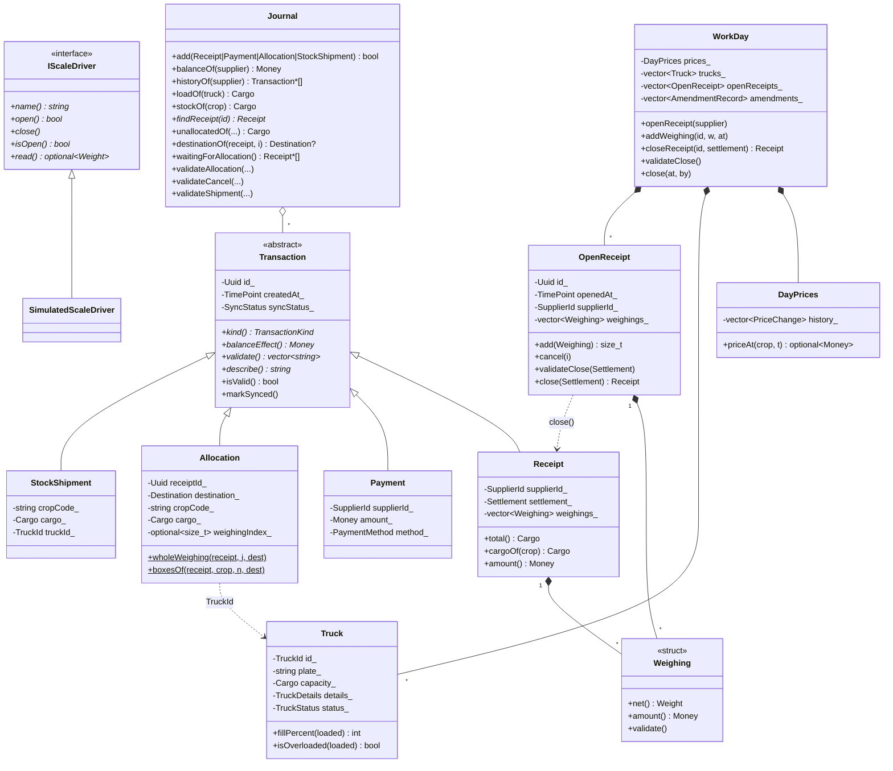
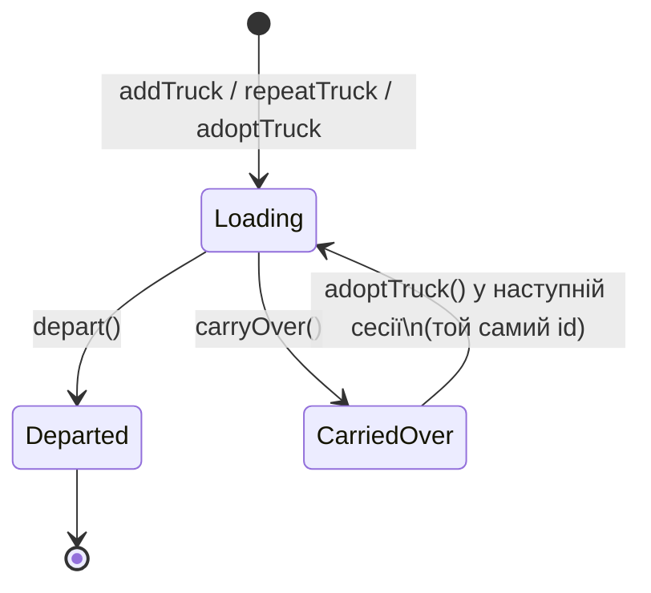

# Доменна модель (`core/`)

Ядро — бібліотека `wms_core`, namespace `wms`, чистий C++20 без Qt. Заголовки —
`core/include/wms/*.h`, реалізація — `core/src/*.cpp`, тести — `tests/*_test.cpp`.

Документ описує кожен клас: навіщо він, які має дані, правила та інваріанти.
Приклади коду — ілюстративні й відповідають реальному API.

## Зміст

1. [Словник предметної області](#1-словник-предметної-області)
2. [Карта класів](#2-карта-класів)
3. [Базові типи: `Quantity`, `Cargo`, `Uuid`](#3-базові-типи)
4. [Довідники: `Supplier`, `Operator`](#4-довідники)
5. [Транзакції: `Transaction` і нащадки](#5-транзакції)
6. [Чек: `Weighing`, `OpenReceipt`, `Receipt`](#6-чек)
7. [Розподіл: `Allocation`, `Destination`, `StockShipment`](#7-розподіл-і-склад)
8. [Фура: `Truck`](#8-фура)
9. [Журнал: `Journal`](#9-журнал)
10. [Ціни: `DayPrices`](#10-ціни)
11. [Сесія: `WorkDay`, `Amendment`](#11-сесія)
12. [Ваги: `IScaleDriver`, `SimulatedScaleDriver`, `StabilityDetector`](#12-ваги)
13. [Утиліти тексту](#13-утиліти-тексту)
14. [Наскрізні сценарії](#14-наскрізні-сценарії)

---

## 1. Словник предметної області

| Термін | Значення | У коді |
|---|---|---|
| Постачальник | людина чи господарство, що привозить ягоду | `Supplier` |
| Оператор | приймальник за терміналом | `Operator` |
| Сесія | робочий день пункту: відкривається ~в обід, може тривати до ранку | `WorkDay` |
| Культура | малина / полуниця / лохина; код рядком (`"raspberry"`) | `std::string cropCode` |
| Зважування | одне зважування на вагах, зазвичай палета однієї культури | `Weighing` |
| Чек | усі зважування одного постачальника за один приїзд | `OpenReceipt` → `Receipt` |
| Роздріб | ціна відома, розрахунок на місці або борг | `Settlement::OnSite` |
| Опт | лише вага, розрахунок поза терміналом | `Settlement::HandedOver` |
| Фура | машина, яку завантажують ягодою | `Truck` |
| Розподіл | частина чека пішла у фуру або на склад | `Allocation` |
| Склад | холодильна камера, живе між сесіями | `ToWarehouse`, `Journal::stockOf` |
| Відвантаження | зі складу у фуру | `StockShipment` |
| Поправка | зміна в уже закритій сесії з поясненням | `Amendment` |

## 2. Карта класів



Файли: кожен клас має пару `core/include/wms/<name>.h` / `core/src/<name>.cpp`
(`Weighing` і `Receipt` — в `receipt.h`, `DayPrices` — в `pricing.h`, `StockShipment` — в `shipment.h`,
ваги — в `scale.h`).

---

## 3. Базові типи

### 3.1 `Quantity<Tag>` — гроші і вага (`quantity.h`)

Строго типізоване ціле число в найменшій одиниці:

```cpp
template <class Tag> class Quantity { std::int64_t raw_; ... };
using Money  = Quantity<MoneyTag>;   // копійки
using Weight = Quantity<WeightTag>;  // грами
```

- **Чому цілі:** `0.1 + 0.2 != 0.3` у `double`; для грошей це неприпустимо.
- **Чому шаблон з тегом:** `Money` і `Weight` — різні типи на етапі компіляції, тож
  `hryvnias(5) + kilograms(2)` не компілюється (статичний поліморфізм).
- Конструктор з числа приватний — значення створюються лише через іменовані фабрики:
  `kopecks(n)`, `hryvnias(n)`, `grams(n)`, `kilograms(n)` або `Quantity::fromRaw(n)`.
- Операції: `+ - += -=`, унарний `-`, множення на ціле, порівняння `<=>`,
  `isZero/isPositive/isNegative`.

Допоміжні функції:

| Функція | Що робить |
|---|---|
| `divideRounded(a, b)` | ділення з комерційним округленням (половина — від нуля) |
| `costOf(weight, pricePerKg)` | `грами × коп/кг ÷ 1000`, округлено до копійки |
| `formatMoney(m)` | `"1234.50 грн"` |
| `formatWeight(w)` | `"12.345 кг"` |
| `parseMoney("85,50")` | ввід оператора: `85`, `85.5`, `85,50`; кома або крапка; від'ємні й сміття → `nullopt` |
| `parseWeight("185,4")` | те саме в кілограмах, до грама (3 знаки) |

`parseMoney` і `parseWeight` мають спільний розбір `parseFixed(text, digits)`: `"85.5"` означає
85 грн **50** коп (дробова частина доповнюється нулями), зайві знаки після коми — помилка,
переповнення `int64` — помилка.

### 3.2 `Cargo` — вантаж у двох вимірах (`cargo.h`)

```cpp
struct Cargo { int boxes = 0; Weight weight; };
```

Фура може бути обмежена ящиками, вагою або обома, тому кількість ягоди завжди описується
парою. Має `+=`, `-=`, `==`.

### 3.3 `Uuid` — ідентифікатор записів (`uuid.h`)

RFC 9562, **версія 7**: перші 48 біт — Unix-час у мілісекундах, далі версія, 74 випадкові біти
і варіант `10xx`.

- Id сортуються за часом створення — зручно для індексу БД і черги синхронізації.
- Генерує клієнт (офлайн), тому два термінали ніколи не видадуть однаковий id.
- `generateV7()` — справжній (випадковість з `thread_local std::mt19937_64`, засіяного
  `std::random_device`); `generateV7(time, randA, randB)` — детермінований для тестів.
- `parse("018f…")` приймає канонічну форму 8-4-4-4-12 без урахування регістру; `toString()`.
- `version()`, `isNil()`, `timestamp()`, порівняння `<=>` (потрібне для `std::set`).

---

## 4. Довідники

### 4.1 `Supplier` (`supplier.h`)

`id` (`SupplierId = int64`), `fullName`, `phone` (необов'язковий).

`matches(query)` — пошук оператора: точний id (`"42"`) **або** частина імені без урахування
регістру, включно з кирилицею (`"шевч"` знайде «Шевченко Тарас»). Використовує `containsIgnoreCase`.

### 4.2 `Operator` (`operator.h`)

`id`, `name`, `pin` (4–6 цифр, інакше `std::invalid_argument`).

PIN — **підтвердження «хто»**, не захист: 4–6 цифр перебираються миттєво, тож хешування лише
створювало б ілюзію безпеки. Проте PIN приватний і ніколи не віддається назовні — є лише
`checkPin(pin)`. Перевірку робить UI; ядро далі отримує вже підтверджений `OperatorId`.

---

## 5. Транзакції

### 5.1 `Transaction` — абстрактна база (`transaction.h`)

Спільне для кожного запису, що потрапляє в журнал і синхронізується:

| Поле | Тип | Призначення |
|---|---|---|
| `id_` | `Uuid` | UUIDv7, ключ ідемпотентності |
| `createdAt_` | `TimePoint` | коли створено |
| `syncStatus_` | `SyncStatus::Pending / Synced` | outbox для синхронізації |

Чисті віртуальні методи (**динамічний поліморфізм**):

| Метод | `Receipt` | `Payment` | `Allocation` | `StockShipment` |
|---|---|---|---|---|
| `kind()` | `Receipt` | `Payment` | `Allocation` | `Shipment` |
| `balanceEffect()` | `+amount()` | `−amount` | `0` | `0` |
| `validate()` | див. нижче | постачальник, сума > 0 | чек, місце, культура, ящики, вага | культура, фура, ящики, вага |
| `describe()` | текст чека з рядками | «Виплата готівкою: …» | «Розподіл …: N ящ. → фура/склад» | «Відвантаження зі складу …» |

Невіртуальний `isValid()` = `validate().empty()`.

**Захист від slicing:** конструктор і копіювання базового класу `protected`, тому скопіювати
`Transaction&` у `Transaction` неможливо — лише через конкретний нащадок. Усі нащадки `final`.

Записи **незмінні**: єдина зміна після створення — `markSynced()`.

### 5.2 `Payment` (`payment.h`)

Гроші, видані постачальнику: `supplierId`, `amount`, `method` (`Cash` / `BankTransfer`).
Зменшує борг: `balanceEffect() = −amount`. Фабрика `Payment::create(...)` видає свіжий UUIDv7.

---

## 6. Чек

### 6.1 `Weighing` — одне зважування (`receipt.h`)

| Поле | Зміст |
|---|---|
| `cropCode` | одна культура (різні культури завжди важаться окремо) |
| `gross` | брутто з ваг |
| `boxCount`, `tarePerBox` | кількість ящиків і вага порожнього ящика |
| `palletTare` | вага палети; оператор вводить щоразу, 0 — без палети |
| `pricePerKg` | **знімок** ціни на момент прийому; 0 для опту |
| `priceSource` | `DayPrice` або `Manual` (разова надбавка; на чеку не видно) |
| `weightSource` | `Scale` або `Manual` (ручне введення маркується) |
| `cancelled` | анульовано: рядок лишається, але ніде не рахується |

Обчислення:

```
tare()   = boxCount × tarePerBox + palletTare
net()    = gross − tare()
amount() = costOf(net(), pricePerKg)     // округлено до копійки на кожен рядок
cargo()  = {boxCount, net()}
```

`validate()` перевіряє лише вагу (культура, брутто > 0, ящики > 0, тара ≥ 0, нетто > 0);
правило про ціну залежить від режиму чека, тому воно в `Receipt`.

**Чому анулювання, а не видалення.** `Allocation` посилається на зважування за *індексом*.
Видалення зсунуло б індекси й «перенесло» палету в чужу фуру. Анульований рядок лишається на
місці, тому індекси стабільні, а слід помилки видно. «Перенести в інший чек» = анулювати тут
і додати там.

### 6.2 `OpenReceipt` — чек, що зважується (`open_receipt.h`)

Змінний об'єкт (тому **не** `Transaction` і не в журналі). Оператор може тримати кілька
відкритих чеків одночасно.

- `OpenReceipt::open(supplier)` — новий id і час. **Id остаточний з самого початку**: палети
  можуть піти у фуру ще до закриття, і їхні `Allocation` посилаються на цей id.
- Повний конструктор `OpenReceipt(id, openedAt, supplier, weighings)` — для відновлення після
  перезапуску (коли з'явиться SQLite).
- `add(weighing)` → індекс рядка; кидає `invalid_argument`, якщо `weighing.validate()` не порожній.
- `cancel(i)` — позначає рядок анульованим.
- `total()`, `cargoOf(crop)` — без анульованих рядків.
- `validateClose(settlement)` — причини, чому не можна закрити (українською).
- `close(settlement)` → незмінний `Receipt` з **тим самим id і часом відкриття**.
  Для опту ціни в рядках обнуляються (зважування брали денну ціну, але опт оцінюється поза
  терміналом).

```mermaid
stateDiagram-v2
    [*] --> Відкритий: WorkDay::openReceipt(supplier)
    Відкритий --> Відкритий: addWeighing / cancelWeighing / Allocation з відкритого
    Відкритий --> Закритий: closeReceipt(OnSite | HandedOver)\n(лише якщо validateClose порожній)
    Закритий --> [*]: Journal::add(Receipt)
```

### 6.3 `Receipt` — закритий чек (`receipt.h`)

`Transaction` з полями `supplierId`, `settlement`, `weighings` (усі, включно з анульованими).

- `total()`, `cargoOf(crop)`, `net()` — без анульованих.
- `amount()` — сума рядків; **0 для опту** (термінал не знає ціни).
- `balanceEffect() = amount()` — роздрібний чек збільшує борг перед постачальником.

`validate()`:

- обрано постачальника;
- є хоча б одне неанульоване зважування;
- кожне неанульоване зважування валідне;
- роздріб: ціна > 0 у кожному рядку; опт: ціна **має бути** 0.

Помилки рядків префіксуються номером: «Зважування 2: Ціна за кг має бути більшою за нуль».

### 6.4 Концепт `WeighedReceipt`

```cpp
template <class R>
concept WeighedReceipt = requires(const R& r, std::string_view crop) {
    { r.id() }          -> std::convertible_to<const Uuid&>;
    { r.weighings() }   -> std::convertible_to<const std::vector<Weighing>&>;
    { r.cargoOf(crop) } -> std::same_as<Cargo>;
};
```

Його задовольняють і `Receipt`, і `OpenReceipt`, хоча спільного базового класу вони не мають.
Завдяки цьому фабрики `Allocation` і перевірки `Journal` працюють з обома — **статичний
поліморфізм** через concept.

---

## 7. Розподіл і склад

### 7.1 `Destination` (`allocation.h`)

```cpp
struct ToWarehouse {};
using Destination = std::variant<TruckId, ToWarehouse>;
```

Замість «магічного id складу» — `std::variant`. `std::visit` з перевантаженими лямбдами змушує
компілятор перевірити, що оброблено кожне місце (статичний поліморфізм). Коли з'являться
морозильні камери, `ToWarehouse` отримає id.

### 7.2 `Allocation`

Факт: частина чека пішла у фуру або на склад. Поля: `receiptId`, `destination`, `cropCode`,
`cargo`, `weighingIndex` (є лише для цілої палети).

Два способи створення (шаблонні, приймають будь-який `WeighedReceipt`):

| Фабрика | Що бере | Вага |
|---|---|---|
| `wholeWeighing(receipt, i, dest)` | зважування `i` цілком | нетто цього зважування |
| `boxesOf(receipt, crop, n, dest)` | `n` ящиків культури з будь-яких палет чека | пропорційно: `вага × n ÷ ящики` |
| `boxesOf(receipt, crop, n, dest, available)` | те саме, але від **залишку** | `available.weight × n ÷ available.boxes` |

**Чому ділити від залишку.** Нехай у чеку 3 ящики по 10 кг, розподіляємо по одному. Якщо щоразу
ділити від усієї культури з округленням, сума трьох частин може не дорівнювати цілому. Коли
ж ділимо від того, що лишилось, останній ящик забирає рівно залишок — грами не губляться й не
з'являються. Тому рекомендований шлях — `Journal::boxesOf(...)`, який сам підставляє залишок.

`balanceEffect() = 0`: переміщення ягоди не змінює борг.

**Чому розподіл — окремий запис, а не лічильник у фурі:** два офлайн-термінали, що вантажать
одну фуру, не перезапишуть дані один одного (див. [architecture.md §4](architecture.md#4-модель-даних-журнал-фактів)).

### 7.3 `StockShipment` (`shipment.h`)

Зі складу у фуру поточної сесії: `cropCode`, `cargo`, `truckId`. Без посилання на чек — на складі
ящики однієї культури вже не розрізняються за постачальником. Рекомендоване створення —
`Journal::shipmentOf(crop, n, truck)` (вага пропорційно від складського залишку).

---

## 8. Фура

### `Truck` (`truck.h`)

| Поле | Зміст |
|---|---|
| `id_` | `TruckId = Uuid` — фури створюються на будь-якому терміналі офлайн |
| `plate_` | номер, обов'язковий |
| `capacity_` | `Cargo`-ліміт; 0 у вимірі = без ліміту, але хоча б один ліміт обов'язковий |
| `details_` | `TruckDetails {make, note}` — марка і вільний текст «водій / куди їде», необов'язкові |
| `status_` | `Loading` → `Departed` або `CarriedOver` |



- `depart()` / `carryOver()` дозволені лише з `Loading` (інакше `logic_error`).
- `acceptsCargo()` — лише у стані `Loading`.
- **Завантаження не зберігається** у фурі — його дає `Journal::loadOf(id)`. Методи фури
  приймають завантаження параметром:
  - `remaining(loaded)` — скільки ще влізе (від'ємне = переповнення);
  - `isOverloaded(loaded)` — перевищено хоча б один заданий ліміт;
  - `fillPercent(loaded)` — за *тіснішим* з двох лімітів, може бути > 100.

---

## 9. Журнал

### `Journal` (`journal.h`)

Append-only сховище фактів. Для кожного типу — окреме перевантаження `add` і окремий вектор
(**статичний поліморфізм через перевантаження**): запитам не потрібно вгадувати тип за
`Transaction&`. Спільна множина `ids_` забезпечує ідемпотентність — `add` повертає `false`,
якщо такий UUID уже є.

**Запити (усе обчислюється):**

| Метод | Результат |
|---|---|
| `balanceOf(supplier)` | Σ `balanceEffect()` чеків і виплат постачальника; + ми винні, − переплачено |
| `historyOf(supplier)` | чеки й виплати постачальника як `const Transaction*`, за часом — звідки баланс |
| `loadOf(truck)` | Σ розподілів у фуру + Σ відвантажень зі складу у фуру |
| `stockOf(crop)` | розподіли на склад − відвантаження; може бути від'ємним після офлайн-конфлікту |
| `unallocatedOf(receiptId, crop)` | скільки культури з закритого чека ще не розподілено |
| `unallocatedOf(openReceipt, crop)` | те саме для відкритого чека |
| `size()` | кількість записів |

**Фабрики з правильним поділом ваги:** `boxesOf(receiptId | openReceipt, crop, n, dest)`,
`shipmentOf(crop, n, truck)`.

**Перевірки для оператора** (повертають список причин; `add` їх *навмисно не викликає*):

| Метод | Правила |
|---|---|
| `validateAllocation(a)` | власний `a.validate()`; чек є в журналі; палета не анульована і ще не розподілена; ящиків не більше, ніж лишилось |
| `validateAllocation(a, openReceipt)` | те саме для відкритого чека (кидає, якщо `a` від іншого чека) |
| `validateCancel(openReceipt, i)` | не анульовано вже; палету не розподілено цілою; після анулювання ящиків культури лишиться не менше, ніж уже розподілено поштучно |
| `validateShipment(s)` | власний `s.validate()`; на складі достатньо ящиків |

Перевіряються **ящики**, а не вага: оператор рахує ящики, вага з них випливає, тож окрема
перевірка ваги лише ловила б шум округлення.

---

## 10. Ціни

### `DayPrices` і `PriceChange` (`pricing.h`)

Ціни однієї сесії як **історія змін** `{cropCode, pricePerKg, at}` у порядку запису.

- `set(crop, price, at)` — лише додає зміну (культура не порожня, ціна > 0).
- `priceAt(crop, t)` — остання зміна **не пізніше** `t`. Вирішує час, а не порядок запису:
  зміни можуть прийти пізніше через sync. При однаковому часі перемагає пізніший запис
  (виправлена описка).
- `current(crop)` = `priceAt(crop, max)`.
- `history()` — видно, коли й на скільки змінювалася ціна.

Приклад: ціну малини підняли о 16:00 з 80 до 85 грн. Зважування о 15:30 отримало 80, о 16:10 — 85.
Навіть якщо запис про зміну дійде пізніше, `priceAt` дасть правильну відповідь.

---

## 11. Сесія

### `WorkDay` (`workday.h`)

Одна робоча сесія: відкривається ~в обід, може тривати до ранку, називається датою відкриття.
Постачальники і борги — спільні (в журналі); **ціни, фури і відкриті чеки — належать сесії**.

**Стан:** `date` (передається ззовні — ядро не знає часового поясу), `openedAt/By`,
`closedAt/By`, `prices`, `trucks`, `openReceipts`, `amendments`.

**Ціни й фури відкритої сесії** (після закриття — `logic_error`):

| Метод | Що робить |
|---|---|
| `setPrice(crop, price, at)` | нова денна ціна |
| `addTruck(plate, capacity, details)` | нова фура |
| `repeatTruck(earlier)` | «повторити фуру з учора»: той самий номер, ліміти, деталі — **новий id**, порожня |
| `adoptTruck(carriedOver)` | прийняти перенесену фуру: **той самий id**, тож завантаження зберігається |
| `departTruck(id)` / `carryOverTruck(id)` | рішення щодо фури |

**Відкриті чеки:**

| Метод | Що робить |
|---|---|
| `openReceipt(supplier)` | повертає відкритий чек постачальника або створює новий — у постачальника не більше одного |
| `addWeighing(id, w, at)` | якщо ціна `DayPrice` — підставляє `prices.priceAt(crop, at)`; ручну не чіпає; без денної ціни рядок лишається без ціни (для опту норм, роздрібний не закриється) |
| `cancelWeighing(id, i, journal)` | лише якщо `journal.validateCancel` порожній |
| `closeReceipt(id, settlement)` | повертає `Receipt` і прибирає чек зі списку; у журнал кладе викликач |

**Закриття сесії:**

- `validateClose()` — список причин: кожен відкритий чек і кожна фура у стані `Loading`
  («закрийте її або перенесіть у наступну сесію»).
- `close(at, by)` — лише коли причин немає.
- `trucksForNextSession()` — фури, перенесені в наступну сесію.

**Поправки в закритій сесії.** `setPrice`, `addTruck`, `departTruck`, `carryOverTruck` мають
перевантаження з `Amendment {by, at, reason}`. Вони дозволені й після закриття, але вимагають
оператора і непорожню причину, а сама зміна логується в `amendments()` як
`AmendmentRecord {amendment, change}` (текст зміни пише `WorkDay`). Невдала зміна не логується.
Реалізовано через приватний шаблон `amend(amendment, description, lambda)`.

---

## 12. Ваги

### 12.1 `IScaleDriver` та `SimulatedScaleDriver` (`scale.h`)

Інтерфейс джерела показів: `name`, `open`, `close`, `isOpen`, `read() → optional<Weight>`.
Ядро знає лише інтерфейс; реальний драйвер COM-порту (`SerialScaleDriver`) з'явиться в `infra/`.

`SimulatedScaleDriver` програє заданий сценарій показів і далі повторює останній —
для демо і тестів без фізичних ваг. `setScript(...)` задає новий сценарій.

### 12.2 `StabilityDetector`

Вага «стабільна», коли останні `windowSize` показів лежать у межах `tolerance` один від одного.
`stableWeight()` — округлене середнє вікна, лише коли стабільно; `lastReading()` — останній показ.

Навіщо: інакше оператор міг би «зловити» вигідне коливання ваги. Промислові ваги мають крок
200 або 500 г, тож усталена вага повторюється точно — у терміналі налаштовано
**3 однакові покази поспіль** (tolerance = 0) при опитуванні 4 рази на секунду.
Нестабільну вагу оператор може підтвердити окремою кнопкою (похибка в один крок некритична).

---

## 13. Утиліти тексту

`text.h`: `foldCase(utf8)` — нижній регістр для ASCII і української кирилиці в UTF-8 (без
залежності від локалі); `containsIgnoreCase(haystack, needle)` — пошук підрядка без урахування
регістру. Використовується в `Supplier::matches`.

---

## 14. Наскрізні сценарії

### 14.1 Роздрібний постачальник, розрахунок на місці

```cpp
WorkDay day{2026y/9/26, now, /*operator*/ 1};
day.setPrice("raspberry", hryvnias(85), now);

const Uuid id = day.openReceipt(42).id();
day.addWeighing(id, {.cropCode = "raspberry", .gross = kilograms(12), .boxCount = 4,
                     .tarePerBox = grams(350), .palletTare = {}}, now);
// нетто = 12 000 − 4×350 = 10 600 г; сума = 10.6 × 85 = 901.00 грн

Journal journal;
journal.add(day.closeReceipt(id, Settlement::OnSite));   // борг +901.00
journal.add(Payment::create(42, hryvnias(901), PaymentMethod::Cash));
journal.balanceOf(42);                                    // 0
```

### 14.2 Великий постачальник: палета у фуру ще під час розвантаження

```cpp
const Truck& truck = day.addTruck("BI1234AA", {.boxes = 1200});
const Uuid big = day.openReceipt(77).id();
day.addWeighing(big, pallet, now);                        // рядок 0

const OpenReceipt& open = *day.findReceipt(big);
Allocation a = Allocation::wholeWeighing(open, 0, truck.id());
if (journal.validateAllocation(a, open).empty()) journal.add(a);
journal.loadOf(truck.id());                               // уже містить палету

// Цей рядок тепер не можна анулювати: validateCancel поверне «вже розподілено».
```

### 14.3 Кінець сесії

```cpp
day.validateClose();   // ["Фура BI1234AA ще завантажується: …"]
day.carryOverTruck(truck.id());
day.close(now, 1);
auto next = day.trucksForNextSession();     // завтра: tomorrow.adoptTruck(next[0])
```
