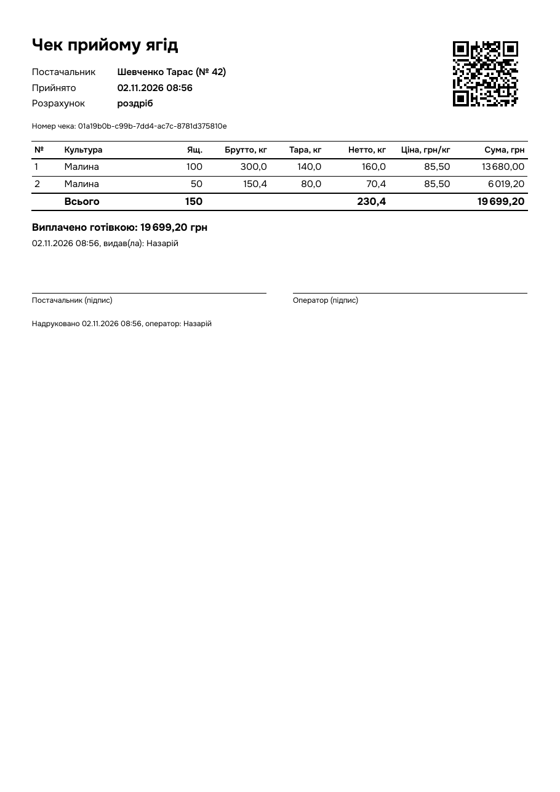

# Лабораторна 3 — звіт-ретроспектива

> **Чернетка.** Технічні факти перевірені на коді й запусках. Позначені місця `[автор: …]` — особистий досвід і
> результат проби на папері, їх має дописати автор.

## Завдання

Термінал мусить видати постачальнику чек — і за роздрібної виплати, і за опту, де папір передають відповідальній
особі. На чеку є QR-код з UUID чека, щоб пізніше знайти запис у системі, не передруковуючи 36 символів вручну.

## Бібліотека

[nayuki QR-Code-generator](https://github.com/nayuki/QR-Code-generator) 1.8.0, C++-версія, ліцензія MIT.

Що робить саме вона: за текстом обирає режим кодування й найменшу версію QR, додає коди Ріда — Соломона, обирає
маску за штрафними правилами стандарту. Нам віддає квадрат темних і світлих модулів.

Що робить наш код: `QrMatrix` (`infra/src/qr_code.cpp`) ховає її типи від решти програми; `Sheet::drawQr`
(`infra/src/receipt_printer.cpp`) малює модули й лишає тиху зону в 4 модулі. Сам чек верстає й друкує Qt
(`QPrinter` + `QPainter`). Qt уже був у курсі й лабу не закриває.

На UUID (36 символів, байтовий режим, рівень M) виходить версія 3, 29×29 модулів. Сторона символу з тихою зоною — до 32 мм,
тобто близько 0,85 мм на модуль.

## Чому ця бібліотека

| Варіант | За | Проти |
|---|---|---|
| **nayuki qrcodegen** | лише генерація, два файли без залежностей, MIT, зрозумілий API | немає декодера (для застосунку не потрібен) |
| libqrencode | поширена, є в репозиторіях дистрибутивів | C API, LGPL, системна залежність на кожному терміналі |
| ZXing-C++ | і генерація, і читання | значно більша, ніж треба для задачі «лише створити QR» |
| Писати самому | немає залежності | Рід — Соломон і маски — це багато коду, не пов'язаного з предметною областю; лаба про інше |

Рівень корекції M (близько 15% пошкоджень) — компроміс для паперу, який м'ється в кишені: вищі рівні збільшили б символ.

## Складність налаштування

Невелика, з однією особливістю: у репозиторії бібліотеки немає `CMakeLists.txt`. Тому `infra/CMakeLists.txt` завантажує
архів через `FetchContent` (з `URL_HASH`, щоб архів не міг непомітно змінитися) і сам оголошує статичну бібліотеку з одного
`qrcodegen.cpp` — так само, як раніше з амальгамацією SQLite. Заголовок підключено як `SYSTEM`, щоб наші суворі попередження
не спрацьовували на чужому коді.

Виклик — один рядок: `QrCode::encodeText(text, Ecc::MEDIUM)`, далі `getSize()` і `getModule(x, y)`.

## Перевірка

- `tests/receipt_printer_test.cpp`: розмір символу зафіксовано (29), шукачі в трьох кутах, різний текст дає різний символ.
- Чи читається QR після всього шляху: чек → PDF → зображення 300 dpi → **OpenCV `QRCodeDetector`** повернув
  точний UUID (разова перевірка, не в тестах, щоб не тягнути OpenCV у проєкт).
- Верстка: тест малює чек довжиною 1–90 палет на зображенні й перевіряє, що нічого не виходить за поля й немає порожніх аркушів.
- Вимкнений принтер перевірено на реальній черзі CUPS: чек збережено, оператор бачить пояснення, завдання в чергу не потрапляє.
- Папір: `[автор: результат друку на Canon E410 — чи читає телефон QR, чи вистачає A5]`.

## Що виявилось несподіваним

Цікаві місця були не в бібліотеці, а довкола неї:

- **Обрізана сума.** Перша версія скорочувала все, що не влазить у клітинку, і на довгому чеку підсумок став `540 000,…`.
  Тести це пропустили: вони перевіряли межі, а не зміст. Знайшлось лише при перегляді PDF. Тепер числа не скорочуються
  ніколи. Автоматичного тесту саме на це нема: перевірено переглядом і текстом PDF.
- **Табличні цифри ламають PDF.** Шрифтова властивість `tnum` на екрані вирівнює стовпці, але в PDF цифри й розділові знаки
  зникли з текстового шару (видно, але не шукається й не копіюється). На чеку `tnum` прибрано.
- **Копія чека виявила дірку в моделі.** Щоб копія показувала виплату, виплата мусить знати свій чек — додано `Payment::receiptId`
  (міграція 11). Старі виплати навмання не прив'язуються.

## Загальний досвід

`[автор: власні висновки — що сподобалось, що зробив би інакше]`

## Ресурси

- Бібліотека й опис API: <https://www.nayuki.io/page/qr-code-generator-library>
- Репозиторій: <https://github.com/nayuki/QR-Code-generator>
- Як влаштований QR крок за кроком: <https://www.nayuki.io/page/creating-a-qr-code-step-by-step>
- Qt: `QPrinter`, `QPainter`, `QPrinterInfo` — <https://doc.qt.io/qt-6/qprinter.html>

## Як виглядає

Демодані, вивід у PDF через `WMS_PRINT_PDF`.
