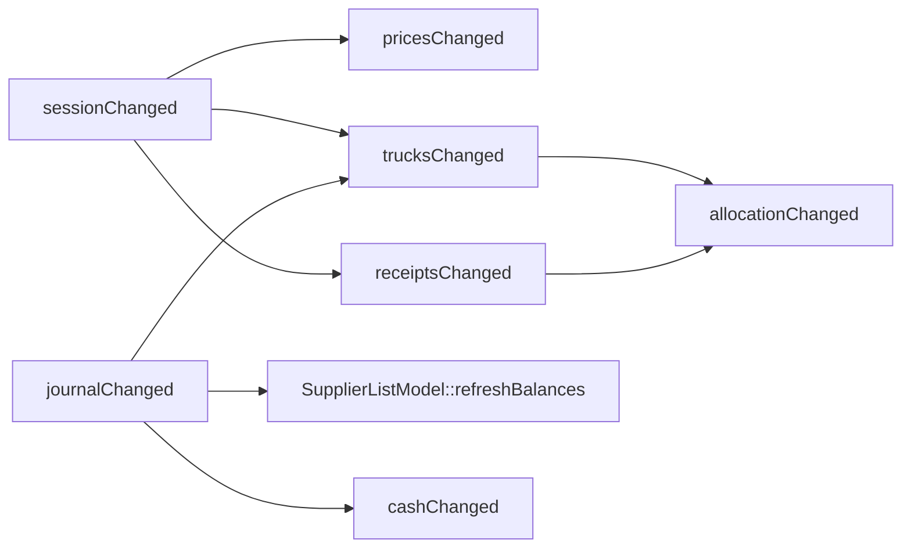

# Інтерфейс термінала (`ui/`)

UI — QML-модуль `BerryWms.Ui` (статична бібліотека `wms_ui`) на Qt 6 Quick / Quick Controls 2.
Він **не містить бізнес-правил**: екрани показують властивості й викликають методи C++-синглтона
`Terminal`, а всі рішення ухвалює ядро.

## 1. Склад модуля

| Файл | Роль |
|---|---|
| `ui/src/terminal.h/.cpp` | `Terminal` — єдиний міст QML → ядро; тримає стан термінала в пам'яті й одразу пише кожну зміну в SQLite |
| `ui/src/supplier_list_model.h/.cpp` | `SupplierListModel` — список постачальників з пошуком для `ListView` |
| `ui/src/scale_monitor.h/.cpp` | `ScaleMonitor` — опитує `IScaleDriver` таймером, веде `StabilityDetector` |
| `ui/src/display_format.h/.cpp` | числа для екрана: `kilogramsText` (`142,6`), `hryvniasText` (`8 823,00`) — кома, вузькі пробіли між тисячами, без одиниці |
| `ui/qml/Main.qml` | вікно: вкладки, футер, перемикання між входом і робочими екранами |
| `ui/style/` | модуль `BerryWms.Style`: власний стиль Qt Quick Controls + `Theme.qml` (токени) + шрифт |
| `ui/qml/screens/LoginScreen.qml` | вхід оператора |
| `ui/qml/screens/SessionScreen.qml` | сесія: ціни, фури, закриття |
| `ui/qml/screens/ReceivingScreen.qml` | прийом: відкриті чеки, ваги, форма, рядки чека |
| `ui/qml/screens/SectionCaption.qml`, `FieldCaption.qml`, `ColumnHeader.qml` | спільні підписи: капітель над групою; підпис поля з підказкою; заголовок колонки таблиці |
| `ui/qml/screens/SupplierPicker.qml` | спливний пошук постачальника (Прийом і Каса) |
| `ui/qml/screens/AllocationScreen.qml` | розподіл: чеки з нерозподіленим, палети/ящики, фури і склад |
| `ui/qml/screens/WarehouseScreen.qml` | склад: залишок за культурами, відвантаження у фуру |
| `ui/qml/screens/CashScreen.qml` | каса: борги, виплата, історія |
| `ui/qml/screens/NoSessionNotice.qml` | заглушка «сесію не відкрито» з кнопкою «До сесії» (Прийом, Розподіл) |

## 2. Вікно (`Main.qml`)

- `ApplicationWindow` відкривається **розгорнутим**, мінімум 1024×600 — цільові пристрої ноутбуки.
- **Масштаб інтерфейсу** — налаштування термінала, а не системи: меню «Масштаб» у футері (100 / 125 / 150 /
  175%, типово 125%). Значення зберігається в `QSettings` (ключ `ui/scale`, QML-тип `Settings` з `QtCore`);
  `main.cpp` читає його **до** створення `QGuiApplication` і виставляє `QT_SCALE_FACTOR` — Qt масштабує все
  разом з діалогами, шрифти лишаються чіткими. Тому зміна діє після перезапуску (кнопка показує «— після
  перезапуску»); `QT_SCALE_FACTOR`, заданий вручну, має пріоритет. Навіщо: системний масштаб Qt враховує, але
  «великий текст» GNOME (`text-scaling-factor`) доходить лише до GTK-програм.
- **Вхід обов'язковий:** поки ніхто не увійшов, видно лише `LoginScreen`; вкладки й футер
  приховані. Після входу чи виходу вкладка скидається на «Сесія».
- **Вкладки** йдуть у порядку робочого дня: Сесія → Прийом → Розподіл → Склад → Каса (`TabBar` +
  `StackLayout`). «Прийом» і «Розподіл» без сесії показують `NoSessionNotice` — пояснення й кнопку
  «До сесії» (сигнал `sessionRequested` → `Main.qml` перемикає вкладку; сесію відкривають свідомо, там).
- **Мова Qt:** `main.cpp` ставить перекладач `qt_uk` (системний пакет `qt6-qttranslations`) незалежно
  від локалі системи — стандартні кнопки діалогів («Скасувати»), контекстне меню полів тощо українською.
- **Футер** завжди показує: постачальника активного чека і його борг, назву сесії (червоним,
  якщо не відкрито), кількість записів у журналі, поточного оператора, кнопку «Вийти».
  Мета — оператор ніколи не губить, чия ягода зараз на вагах. Там же перемикач світлої/темної теми.
- **Тема:** контроли малює власний стиль (§2.2); вікно ще й передає токени в `palette` — для
  контролів, яких стиль не перевизначає (вони беруть вигляд Basic, а Basic малює з палітри).

### 2.1 Дизайн-токени (`ui/style/Theme.qml`)

Єдине місце з літеральними кольорами й розмірами; в екранах — лише `Theme.*`
(жодних `"#…"`, `palette.*` чи чисел у `font.pixelSize`). Значення взято з HTML-макета «Прийому».

- **Кольори:** `bg`, `surface`, `surfaceAlt`, `border`, `text`, `textMuted`; один акцент `accent`
  (+ `accentSoft`, `textOnAccent`) — головні дії й виділення; стани окремо від акценту: `ok`, `warn`,
  `danger` (+ `dangerSoft`); табло ваг — прилад, темне в обох темах: `scaleBg`, `scaleDigit`,
  `scaleDigitUnstable`, `scaleDim`.
- **Тема:** `Theme.dark` спершу слідує за системою (`Application.styleHints.colorScheme`);
  перемикач у футері присвоює значення явно (прив'язка до системи розривається — так і задумано).
- **Розміри:** відступи `spacingXs…Xl` (4/8/12/16/24), радіуси `radiusS/M` (4/8), висота
  контролу 40 / велика 48, шрифти `fontSizeCaption…Scale` (12…64).
- **Шрифт:** Onest (Regular/Medium/SemiBold/Bold) вбудовано в ресурси модуля (`ui/style/fonts/`, OFL 1.1),
  завантажує `Theme` через `FontLoader`; `Theme.fontUi` — його родина. Окремого моноширинного
  шрифту нема: вікно вмикає табличні цифри (`font.features: Theme.fontFeatures`, `tnum`) — усі цифри
  однакової ширини, тож вага й суми стають стовпчиками, а табло ваг не «стрибає».
- `disabledOpacity` (0.4) — вимкнений контрол; `overlay` — затемнення під модальним діалогом.
- **Урок:** назва властивості не може починатися з `on` + велика літера — QML вважає її
  обробником сигналу. Токен `onAccent` мовчки давав `undefined` (текст на акценті ставав
  чорним — у темній темі це було непомітно), тому він `textOnAccent`.

### 2.2 Власний стиль (`BerryWms.Style`)

Модуль `ui/style/` — стиль Qt Quick Controls. `main.cpp` вмикає його до завантаження QML
(`QQuickStyle::setStyle("BerryWms.Style")`), тож кожен `Button`, `TextField`… в екранах —
наш, без змін в екранах. Кожен файл наслідує шаблон з `QtQuick.Templates` (поведінка без
вигляду: натискання, фокус, `highlighted`) і малює `background`/`contentItem` з токенів `Theme`.
Чого в модулі нема — береться з Basic (`IMPORTS QtQuick.Controls.Basic` у CMake).

| Контрол | Вигляд |
|---|---|
| `Button` | обведена (типова); `highlighted` — заливка акцентом, **одна головна дія панелі**; `flat` — лише текст |
| `ToolButton` | лише текст, фон при наведенні (футер, «✕» у рядках) |
| `TextField` | висота 40, текст 16 (числа читаються), рамка акцентом у фокусі |
| `ComboBox` | як поле; спливний список до 8 рядків, рядки — наш `ItemDelegate` |
| `ItemDelegate` | рядок списку; `highlighted` — м'який акцент (обраний чек/постачальник) |
| `TabBar` / `TabButton` | вкладки висотою 48, поточна — лінія акценту знизу |
| `ToolBar` | футер: поверхня + тонка лінія зверху, дрібний текст |
| `Frame`, `Popup`, `Dialog` | поверхня, рамка, радіус 8; діалог — жирний заголовок, затемнення під ним |
| `DialogButtonBox` | кнопки праворуч; стандартна кнопка «прийняти» — `highlighted` |
| `WarningButton` | обведена бурштиновим — свідома ризикована дія поруч із головною («Прийняти нестабільну») |
| `RadioButton`, `ProgressBar`, `ScrollBar`, `ToolTip` | акцентні індикатори; тонкий скролбар; підказка інвертованими кольорами |

Фокус клавіатури скрізь видно (рамка акцентом): оператор працює Tab/Enter.
Модуль залежить лише від Qt (не від `BerryWms.Ui`); `BerryWms.Ui` імпортує його (`IMPORTS`),
тож `Theme` доступний в екранах через `import BerryWms.Ui`.

## 3. Екрани

### 3.1 Вхід оператора

Список операторів (`Terminal.operators`, без PIN) + поле PIN (4–6 цифр) + «Увійти».
Невірний PIN — повідомлення «Невірний PIN». `Terminal.login(id, pin)` повертає `bool`;
перевірка — `Operator::checkPin` у ядрі.

### 3.2 Сесія

**Без відкритої сесії:** кнопка «Відкрити сесію». Сесія відкривається від імені поточного
оператора й називається локальною датою («Сесія 26.09.2026»). Фури, перенесені з попередньої
сесії, додаються автоматично разом із завантаженням.

**Відкрита сесія** — у стилі «Прийому»: заголовок і дві панелі (`Frame`).

- угорі — назва сесії, хто і коли відкрив, «Закрити сесію…» (активна лише без причин-блокерів);
- **причини, чому сесію не можна закрити,** видно одразу — списком «Щоб закрити сесію:» у кольорі
  попередження (це перелік справ, а не помилка) — це `WorkDay::validateClose()`;
- **ліворуч — ціни дня, грн/кг:** рядок на культуру — назва, поточна ціна великими цифрами
  (або бурштинове «не задано») і поле «нова»; одна головна кнопка «Зберегти ціни» записує всі
  заповнені поля; помилка — під своїм рядком; під ними — **«Додати культуру…»**: діалог з назвою, дубль
  (`validateNewCrop`) видно під полем під час введення, кнопка тоді неактивна. Додавання перебудовує рядки цін
  (`cropsChanged`), тож недозбережені нові ціни стираються — дія рідкісна, тому прийнятно;
- **по центру — фури сесії таблицею:** фура (номер · марка, під ним «водій / куди»), ящиків і кг —
  голі числа (`loadBoxes`, `loadKg`) з лімітом дрібно під ними («з 400» / «без ліміту»),
  заповнення у відсотках зі смугою (переповнення — червоним «понад»); для фур, що вантажаться, —
  «Відправити» і «Перенести», для решти — статус. Ширини колонок спільні для заголовка й рядків;
- **«Додати фуру…»** у заголовку панелі відкриває діалог: номер, марка, ліміти ящиків і кг (порожній =
  без ліміту, але хоча б один потрібен), «водій / куди їде»; нижче — **повторити фуру з минулої сесії**
  (`ComboBox` з учорашніх фур — той самий номер і ліміти, новий id). Діалог закривається після успіху,
  помилка лишається в ньому. Форма винесена в діалог, щоб таблиця фур мала всю ширину на 1024 px;
- закриття — через діалог підтвердження: «Після закриття змінити сесію можна лише поправкою з
  поясненням».

Спільні для екранів підписи — `SectionCaption.qml` (капітель над групою) і `FieldCaption.qml`
(підпис поля з підказкою в тому ж рядку).

### 3.3 Прийом

Доступний лише у відкритій сесії. Розкладка — за HTML-макетом: три панелі (`Frame`).

**Ліворуч — відкриті чеки.** Головна кнопка «Новий чек · F2» відкриває `SupplierPicker`. Список
відкритих чеків: постачальник, час відкриття, сума в гривнях (або «порожній»); обраний рядок
підсвічений м'яким акцентом. Клік робить чек **активним** — саме в нього підуть наступні
зважування. Повторний вибір того самого постачальника повертає до його відкритого чека.

**По центру — ваги і форма.**

- **табло-прилад** (темне в обох темах): число `display` великими цифрами + «кг»; лампи
  СТАБ (`stable`), НУЛЬ (`zero`), БРУТТО; цифри зелені, коли стабільно, бурштинові, поки вага
  змінюється. Під табло — назва драйвера й кнопки симулятора «Поставити палету» / «Зняти»;
- **культура — великими кнопками** (назва + денна ціна або «ціни немає»); одна клавіша — один
  вибір. Якщо культур більше 6, кнопками стають 5 (`Terminal.cropKeys`), решта — у кнопці «Ще ▾»
  (спливний список). Культура, обрана з «Ще», зважена або з новою денною ціною, **піднімається на
  місце кнопки, використаної найдавніше** (`CropKeys`); решта кнопок не рухається — рука знаходить
  культуру там, де вона була. Розкладка своя на термінал: `QSettings` `ui/cropKeys`, `ui/cropsRecent`;
- **дві групи полів.** Перша — що лишається між палетами: ціна грн/кг (порожньо = денна, вона ж
  у підказці поля) і тара ящика. Друга, над кнопкою запису, — що вводиться на кожну палету:
  ящиків, палета кг (0 — без палети), вага вручну (порожньо — з ваг); ці поля більші.
  Підказка стоїть у рядку назви поля праворуч, тож поля ряду починаються на одній висоті
  (підписи — перший рядок `GridLayout`, поля — другий);
- «Записати зважування · Enter» (головна) — лише зі **стабільною** вагою або з ручною;
  «Прийняти нестабільну» (`WarningButton`, бурштинова) — окрема свідома дія оператора;
- після запису культура й тара ящика лишаються, решта полів чиститься, фокус — на «Ящиків».

**Праворуч — активний чек таблицею.** Заголовок: постачальник, час відкриття, борг до чека.
Стовпці: № · Культура · Ящ. · Нетто, кг · Ціна · Сума, грн · ✕ — одиниці лише в заголовках,
у рядках голі числа (`142,6`, `8 823,00`). Брутто і тара — у підказці при наведенні на нетто.
Значення, введене вручну (вага чи ціна), — бурштинове із зірочкою (`85,00*`), пояснення під
таблицею. Анульований рядок закреслений, замість «✕» — «анул.»; «✕» анулює рядок або показує,
чому не можна (`Journal::validateCancel` — наприклад, палета вже у фурі). Внизу — підсумок
(ящики, нетто, «Разом, грн» великими) і «Закрити чек…».

**Діалог закриття чека:** роздріб («ціна відома, розрахунок тут — зараз або пізніше») чи опт
(«лише вага, чек передається відповідальній особі»). Причини з `OpenReceipt::validateClose`
показуються для обраного режиму; «Закрити чек» активна, лише коли причин немає. Після закриття
чек потрапляє в журнал, активним стає наступний відкритий.

### 3.4 `SupplierPicker`

Спливне вікно з полем «Пошук: номер або частина прізвища» і `ListView` результатів з боргом
кожного постачальника. Enter бере єдиний збіг; «Нікого не знайдено» при порожньому результаті.

### 3.5 Розподіл (`AllocationScreen.qml`)

Три панелі (`Frame`) у стилі «Прийому»:

- **Зліва — чеки до розподілу** (`allocationSources`): спершу відкриті чеки сесії («зважується» —
  палети йдуть у фуру ще під час розвантаження), потім закриті з журналу, у яких лишились ящики
  (`Journal::waitingForAllocation`). Рядок: постачальник, час · стан, праворуч «N ящ.» (`leftBoxes`).
  Повністю розподілений чек зникає зі списку, але лишається обраним, щоб оператор бачив, куди все пішло.
- **Справа — куди**: фури сесії, що ще завантажуються: номер · марка, «40 / 400 ящ.» і «128,0 кг» (голі
  `loadBoxes`/`limitBoxes`, `loadKg`/`limitKg`), смуга заповнення з відсотком, переповнення — червоним
  «понад» (лише показ, не заборона); наприкінці «Склад» із залишком за культурами. Оператор обирає місце
  один раз, далі шле в нього кілька палет.
- **По центру — обраний чек**: заголовок (постачальник; час · стан · скільки лишилось), смуга «Куди: …»
  (м'який акцент; бурштинове «Оберіть фуру або склад», поки не обрано). Далі **таблиця палет** (№ ·
  культура · ящ. · нетто, кг · де): вільна палета — кнопка «Палету →», розміщена — «у фурі …» / «на
  складі» (`Journal::destinationOf`), анульована — закреслена. Нижче — «Ящиками — вага пропорційно»:
  для кожної культури із залишком «лишилось N ящ. · M кг», поле кількості й «Відвантажити».

Обраний чек розподілу **окремий від активного чека прийому**: завантаження фури не змінює, куди
піде наступне зважування. Обране місце тримає QML; ядро перевіряє його при кожному розподілі
(фура цієї сесії й ще завантажується).

### 3.6 Склад (`WarehouseScreen.qml`)

Склад не зникає між сесіями, тож залишок видно й без відкритої сесії.

- **Зліва — залишок** (`stock`) таблицею «Культура · Ящ. · Вага, кг» (голі числа; порожні культури
  приглушені). Від'ємний залишок (два термінали офлайн відвантажили ті самі ящики) — червоним: факти
  не відхиляються, розбирається логіст. Над таблицею смуга «Куди: <фура>»; у відкритій сесії біля
  культури із залишком — поле кількості й «У фуру →» (колонка фіксованої ширини).
- **Справа — фури сесії**, що ще завантажуються (ті самі дані, що й на «Розподілі», без самого складу).

Відвантаження — `shipFromStock(crop, boxes, truckId)`: `Journal::shipmentOf` ділить вагу із
залишку (останні ящики забирають рівно залишок ваги), `validateShipment` не дає взяти більше, ніж є.
На склад ягода потрапляє лише з чека — на екрані «Розподіл».

### 3.7 Каса (`CashScreen.qml`)

Борги спільні для всіх сесій, тож каса працює й без відкритої сесії.

- **Зліва — борги** (`debtors`): постачальники з ненульовим балансом, найбільший борг зверху;
  переплачені (винні нам) — червоним унизу. «Постачальник · F2» — той самий `SupplierPicker`.
- **По центру — обраний постачальник** (`cashSupplierId`, окремий від активного чека прийому):
  борг, сума (`parseMoney`, «Весь борг» підставляє `cashDebtInput`), готівка / переказ,
  «Виплатити…» → діалог підтвердження з боргом після виплати (`balanceAfter`; він же підказкою
  «лишиться …» над полем суми). Суми на екрані — `hryvniasText` (мінус U+2212). Виплатити більше,
  ніж борг, можна (аванс) — діалог попереджає, що постачальник буде винен нам.
- **Справа — історія** (`cashHistory` з `Journal::historyOf`): чеки й виплати в порядку часу.
  Текст дає віртуальний `describe()` (перший рядок — заголовок, решта — рядки чека), суму зі
  знаком — `balanceEffect()`: екран не знає, якого типу запис.
  Під виплатою — хто її видав («видав(ла): Оксана», `Payment::paidBy`).

## 4. `Terminal` — міст QML → ядро

`QML_SINGLETON`. Стан живе в пам'яті, а кожна зміна одразу пишеться в локальну базу
(перезапуск чи збій нічого не губить):

| Поле | Зміст |
|---|---|
| `db_`, `journalStore_`, `sessionStore_`, `operatorStore_`, `supplierStore_` | база термінала й сховища поверх неї; оголошені першими — з них завантажується решта |
| `operators_`, `suppliers_` | довідники з бази (`SqliteRepository<T>::all()`); порожня таблиця заповнюється демо-набором (`loadOrSeed`) |
| `previousTrucks_` | фури останньої закритої сесії (`SessionStore::lastClosed`) — для «повторити» і перенесення |
| `workDay_` | `std::optional<WorkDay>` — відкрита сесія (`SessionStore::current`) |
| `journal_` | `Journal` (`JournalStore::load`) |
| `supplierModel_`, `simulator_`, `scaleMonitor_` | модель списку, симулятор ваг і монітор |
| `activeReceiptId_` | UUID активного чека — **не вказівник**, бо відкриті чеки живуть у векторі, що перевиділяє пам'ять |
| `allocationReceiptId_` | UUID чека, обраного на екрані «Розподіл» (відкритого або закритого) |
| `currentOperatorId_` | хто увійшов |

Порядок оголошення полів важливий: модель і монітор оголошені після даних, які читають, тож
конструюються після них.

**Збереження.** Після кожної зміни сесії — `saveSession()` (знімок `WorkDay`: ціни, фури, відкриті чеки
з рядками). Запис журналу — `record(x)`: спершу в сховище, потім у `journal_`, щоб екран ніколи не
показував того, що загубить перезапуск. Закриття чека — чек у журнал і знімок сесії без нього в одній
зовнішній транзакції. Після перезапуску жоден чек не активний — оператор обирає його зліва (як після виходу).
Помилка запису (напр., диск повний) — виняток і аварійне завершення: дані в базі лишаються
узгодженими завдяки транзакціям, а мовчки працювати далі без запису гірше.

**Де база.** `QStandardPaths::AppDataLocation` / `terminal.db` (у Linux —
`~/.local/share/BerryWms/Berry WMS Terminal/terminal.db`). Змінна `WMS_DATABASE` задає інший файл
або `:memory:` — запуск без сліду.

**Бекап.** `Terminal::backup()` робить копію при запуску (стан, яким його лишив минулий запуск) і після
закриття сесії (увесь день) у теку `backups/` поруч із базою: `backupDatabase` (infra) → `VACUUM INTO`,
назва `terminal-YYYYMMDD-HHMMSS.mmmZ.db` (UTC), зберігаються 30 останніх (≈ місяць сесій). Копія — один
самодостатній файл. Помилка бекапу лише пишеться в лог (`qWarning`) — прийом важливіший. Для `:memory:`
бекапу нема. **Відновлення:** закрити термінал, скопіювати потрібну копію поверх `terminal.db`, видалити
`terminal.db-wal` і `terminal.db-shm`. Копії лежать на тому самому диску — від його поломки рятує sync із сервером.

### 4.1 Властивості (читання)

| Властивість | Сигнал | Зміст |
|---|---|---|
| `operators` | CONSTANT | оператори без PIN (для списку входу) |
| `loggedIn`, `operatorName` | `operatorChanged` | вхід |
| `sessionOpen`, `sessionTitle`, `sessionOpenedBy` | `sessionChanged` | сесія |
| `crops` | — (CONSTANT) | `[{cropCode, name}]` — стала модель рядків |
| `prices` | `pricesChanged` | `{cropCode: "85,00"}` — число без одиниці |
| `trucks` | `trucksChanged` | фури сесії з завантаженням, % і статусом |
| `previousTrucks` | `sessionChanged` | учорашні фури для «повторити» |
| `closeBlockers` | `trucksChanged` | `WorkDay::validateClose()` |
| `openReceipts`, `activeReceiptId`, `activeLines`, `activeSummary` | `receiptsChanged` | прийом; вага й гроші — голі числа для таблиці (`display_format.h`) |
| `allocationSources`, `allocationReceiptId`, `allocationSupplierName`, `allocationLines`, `allocationCrops`, `destinations` | `allocationChanged` | розподіл |
| `stock` | `journalChanged` | `[{cropCode, name, boxes, kg, empty, negative}]` — залишок складу за культурами (`kg` — голе число) |
| `debtors` | `journalChanged` | `[{supplierId, name, balance, overpaid}]` — ненульові баланси |
| `cashSupplierId`, `cashSupplierName`, `cashBalance`, `cashDebtInput`, `cashHistory` | `cashChanged` | каса |
| `hasSupplier`, `supplierName` | `currentSupplierChanged` | постачальник активного чека |
| `supplierBalance` | `balanceChanged` | його борг, `"3 885,00 грн"` |
| `journalSize` | `journalChanged` | записів у журналі |
| `suppliers` | CONSTANT | `SupplierListModel*` |
| `scales` | CONSTANT | `ScaleMonitor*` |

### 4.2 Методи (дії)

Методи, які може зламати ввід оператора, повертають **`QString` з помилкою українською**
(порожній рядок — успіх), тож QML не обробляє винятки ядра.

| Метод | Що робить |
|---|---|
| `login(id, pin)` → `bool`, `logout()` | вхід / вихід (відкриті чеки лишаються з сесією) |
| `openSession()`, `closeSession()` | відкрити / закрити (закриття — лише без блокерів) |
| `setPrice(crop, text)` | нова денна ціна з тексту (`parseMoney`) |
| `addTruck(plate, make, note, boxes, kg)`, `repeatTruck(i)` | фури |
| `departTruck(id)`, `carryOverTruck(id)` | рішення щодо фури |
| `startReceipt(supplierId)`, `activateReceipt(id)` | відкрити / обрати активний чек |
| `recordWeighing(crop, boxes, tare, pallet, price, manualWeight, acceptUnstable)` | зважування в активний чек |
| `cancelWeighing(i)` | анулювати рядок або повернути причину |
| `receiptCloseBlockers(wholesale)`, `closeReceipt(wholesale)` | закриття чека |
| `selectAllocationReceipt(id)` | обрати чек для розподілу |
| `allocateWeighing(i, destinationId)`, `allocateBoxes(crop, boxes, destinationId)` | палету / N ящиків — у фуру (UUID) або на склад (`"warehouse"`) |
| `shipFromStock(crop, boxes, truckId)` | N ящиків зі складу у фуру сесії |
| `selectCashSupplier(id)`, `balanceAfter(amount)` | каса: обрати постачальника / борг після виплати |
| `pay(amount, bankTransfer)` | виплата `Payment` обраному постачальнику |
| `simulatePallet()`, `simulateEmptyScale()` | керування симулятором ваг |

### 4.3 Каскад сигналів



`sessionChanged` означає лише «відкрито / закрито». Завантаження фур залежить і від сесії, і від
журналу, тому `trucksChanged` під'єднано до обох. Екран розподілу залежить від фур, журналу й
відкритих чеків — `allocationChanged` іде від `trucksChanged` і `receiptsChanged`.

### 4.4 Відкритий чи закритий чек: `std::visit`

Розподіляти можна і з відкритого чека (`OpenReceipt`, ще не в журналі), і з закритого (`Receipt`).
`Terminal` тримає обраний як `std::variant<const OpenReceipt*, const Receipt*>`, а різницю в
запитах до журналу (`unallocatedOf(receipt, …)` проти `unallocatedOf(id, …)`) ховають перевантажені
функції `unallocated()` / `check()` у `terminal.cpp`. Тоді один узагальнений лямбда-вираз у
`std::visit` обслуговує обидва типи, а `Allocation::wholeWeighing/boxesOf` приймають будь-який
`WeighedReceipt`.

### 4.5 Урок: стала модель рядків

`Repeater` над списком, що змінюється, **перебудовує всі рядки** — і стирає текст, який оператор
саме вводить. Тому на екрані сесії рядки цін будуються зі сталого `crops`, а змінні ціни беруться
з окремої властивості `prices` за ключем.

## 5. `SupplierListModel`

`QAbstractListModel` над `std::vector<Supplier>` термінала. Не копіює дані — тримає лише індекси
рядків, що підходять під `query` (`Supplier::matches`).

- ролі: `id`, `name`, `phone`, `balance` (з `Journal::balanceOf`, відформатовано);
- `idAt(row)` — id постачальника видимого рядка;
- `refreshBalances()` — викликається на `journalChanged`, бо баланси похідні від журналу.

## 6. `ScaleMonitor`

Опитує драйвер кожні **250 мс** і проганяє покази через `StabilityDetector` (вікно 3 покази,
допуск 0 г). Знає драйвер лише як `IScaleDriver`, тож симулятор і майбутній драйвер COM-порту
взаємозамінні. Якщо драйвер втратив з'єднання, пробує відкрити його знову на наступному тіку.
Сигнал `readingChanged` випускається лише коли змінився показ або стабільність — більшість тіків
повторює ту саму вагу.

Властивості для QML: `display` (лише число, `"12,4"`, або `"—"`; «кг» — окремий підпис на табло),
`stable`, `zero` (порожні ваги — лампа НУЛЬ), `driverName`.
Для C++: `stableWeight()` (єдина вага, з якою можна записати зважування без підтвердження) і
`lastReading()` (для «Прийняти нестабільну»).

Симулятор у `Terminal` має крок 200 г; «Поставити палету» програє сценарій
«ставлять → коливання → усталення» на випадковій вазі.

## 7. Демо-дані

Довідники до появи сервера: якщо таблиця `supplier`/`operator`/`crop` порожня, `loadOrSeed` записує в неї
демо-набір з `terminal.cpp`. Сесію й історію `seedDemoData()` записує лише в **нову** базу (немає сесій
і журнал порожній). Далі все це звичайні дані:

- оператори: **Назарій** (PIN `1111`), **Оксана** (PIN `2222`);
- постачальники: #42 Шевченко Тарас, #43 Коваленко Олена, #44 Бондар Петро, #45 Мельник Ірина,
  #77 ФГ «Ягідний край»;
- культури: малина, полуниця, лохина (`demoCrops`);
- «вчорашня» закрита сесія: фура `BI1234AA` відправлена, `BI5678BB` перенесена з однією палетою;
- історія: роздрібний чек Шевченка (120 кг брутто, 40 ящ., 85 грн/кг), його палета у фурі
  `BI5678BB`, виплата 3000 грн — щоб було видно борг; чек Мельник (полуниця, 30 ящ.), палета
  якого ночувала на складі, — щоб екран «Склад» не був порожнім.

## 8. Перевірка QML

```bash
cmake --build build --target wms_ui_qmllint
```

Лінтер запускається на кожному кроці розробки UI; збірка C++-частини — з тими самими
`-Wall -Wextra -Wpedantic -Wshadow`, що й ядро.
