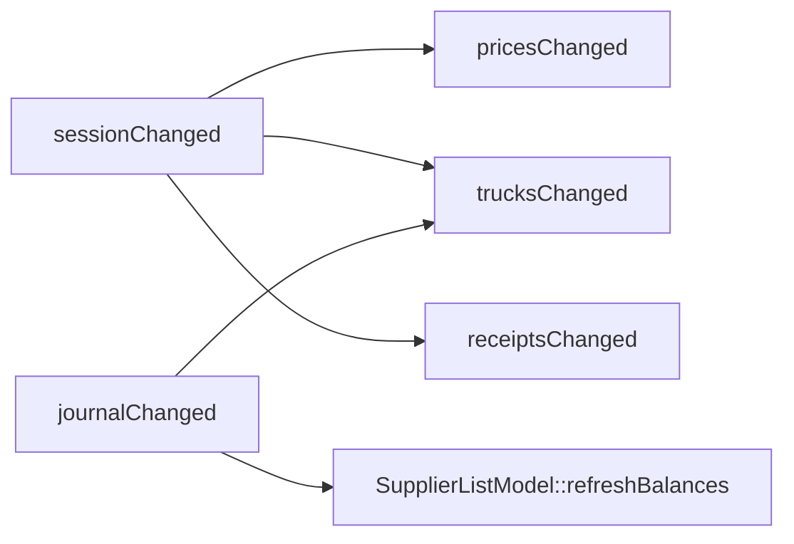

# Інтерфейс термінала (`ui/`)

UI — QML-модуль `BerryWms.Ui` (статична бібліотека `wms_ui`) на Qt 6 Quick / Quick Controls 2.
Він **не містить бізнес-правил**: екрани показують властивості й викликають методи C++-синглтона
`Terminal`, а всі рішення ухвалює ядро.

## 1. Склад модуля

| Файл | Роль |
|---|---|
| `ui/src/terminal.h/.cpp` | `Terminal` — єдиний міст QML → ядро; тримає стан термінала в пам'яті |
| `ui/src/supplier_list_model.h/.cpp` | `SupplierListModel` — список постачальників з пошуком для `ListView` |
| `ui/src/scale_monitor.h/.cpp` | `ScaleMonitor` — опитує `IScaleDriver` таймером, веде `StabilityDetector` |
| `ui/qml/Main.qml` | вікно: вкладки, футер, перемикання між входом і робочими екранами |
| `ui/qml/screens/LoginScreen.qml` | вхід оператора |
| `ui/qml/screens/SessionScreen.qml` | сесія: ціни, фури, закриття |
| `ui/qml/screens/ReceivingScreen.qml` | прийом: відкриті чеки, ваги, форма, рядки чека |
| `ui/qml/screens/SupplierPicker.qml` | спливний пошук постачальника (стане в пригоді й у Касі) |
| `ui/qml/screens/AllocationScreen.qml` | розподіл — заглушка |
| `ui/qml/screens/CashScreen.qml` | каса — заглушка |

## 2. Вікно (`Main.qml`)

- `ApplicationWindow` відкривається **розгорнутим**, мінімум 1024×600 — цільові пристрої ноутбуки.
- **Вхід обов'язковий:** поки ніхто не увійшов, видно лише `LoginScreen`; вкладки й футер
  приховані. Після входу чи виходу вкладка скидається на «Сесія».
- **Вкладки** йдуть у порядку робочого дня: Сесія → Прийом → Розподіл → Каса (`TabBar` +
  `StackLayout`).
- **Футер** завжди показує: постачальника активного чека і його борг, назву сесії (червоним,
  якщо не відкрито), кількість записів у журналі, поточного оператора, кнопку «Вийти».
  Мета — оператор ніколи не губить, чия ягода зараз на вагах.

## 3. Екрани

### 3.1 Вхід оператора

Список операторів (`Terminal.operators`, без PIN) + поле PIN (4–6 цифр) + «Увійти».
Невірний PIN — повідомлення «Невірний PIN». `Terminal.login(id, pin)` повертає `bool`;
перевірка — `Operator::checkPin` у ядрі.

### 3.2 Сесія

**Без відкритої сесії:** кнопка «Відкрити сесію». Сесія відкривається від імені поточного
оператора й називається локальною датою («Сесія 26.09.2026»). Фури, перенесені з попередньої
сесії, додаються автоматично разом із завантаженням.

**Відкрита сесія:**

- заголовок, хто і коли відкрив, кнопка «Закрити сесію» (активна лише без причин-блокерів);
- **причини, чому сесію не можна закрити,** видно одразу — це `WorkDay::validateClose()`;
- **ціни за кг:** рядок на кожну культуру з поточною ціною і полем «нова, грн»;
  одна кнопка «Зберегти ціни» записує всі заповнені поля;
- **фури сесії:** номер, марка, примітка, «Завантажено: X з Y», відсоток, позначка переповнення,
  статус; для фур, що вантажаться, — «Відправити» і «Перенести»;
- **додати фуру:** номер, марка, ліміт ящиків, ліміт кг, «водій / куди їде»; порожній ліміт = без
  ліміту, але хоча б один потрібен;
- **повторити фуру з минулої сесії** (`ComboBox` з учорашніх фур) — той самий номер і ліміти, новий id;
- закриття — через діалог підтвердження: «Після закриття змінити сесію можна лише поправкою з
  поясненням».

### 3.3 Прийом

Доступний лише у відкритій сесії. Три колонки:

**Ліворуч — відкриті чеки.** Кнопка «Новий чек (F2)» відкриває `SupplierPicker`. Список
відкритих чеків (постачальник, час відкриття, ящики/вага); клік робить чек **активним** — саме
в нього підуть наступні зважування. Повторний вибір того самого постачальника повертає до його
відкритого чека (у ядрі їх не буває два).

**По центру — ваги і форма.**

- табло: поточний показ, ознака стабільності, назва драйвера; кнопки симулятора
  «Поставити палету» (ваги «гойдаються» й усталюються) і «Зняти»;
- поля: культура (`ComboBox`), ящиків, тара ящика кг, палета кг (щоразу; 0 — без палети),
  ціна грн/кг (порожньо = денна; підказка показує денну ціну), вага вручну кг (порожньо = з ваг);
- «Записати зважування» — лише зі **стабільною** вагою або з ручною;
  «Прийняти нестабільну» — окрема свідома дія оператора;
- після запису культура й тара ящика лишаються (наступна палета зазвичай така сама), решта
  полів чиститься.

**Праворуч — рядки активного чека.** Для кожного: номер, культура, ящики, «брутто − тара = нетто»,
ціна → сума, позначки ручної ціни / ручної ваги. Анульовані рядки **закреслені**. Кнопка «✕»
анулює рядок або показує, чому не можна (`Journal::validateCancel` — наприклад, палета вже у фурі).
Внизу — «Разом» і борг постачальника до цього чека, кнопка «Закрити чек…».

**Діалог закриття чека:** роздріб («ціна відома, розрахунок тут — зараз або пізніше») чи опт
(«лише вага, чек передається відповідальній особі»). Причини з `OpenReceipt::validateClose`
показуються для обраного режиму; «Закрити чек» активна, лише коли причин немає. Після закриття
чек потрапляє в журнал, активним стає наступний відкритий.

### 3.4 `SupplierPicker`

Спливне вікно з полем «Пошук: номер або частина прізвища» і `ListView` результатів з боргом
кожного постачальника. Enter бере єдиний збіг; «Нікого не знайдено» при порожньому результаті.

### 3.5 Розподіл і Каса

Поки заглушки. Ядро для них уже готове: `Allocation`, `StockShipment`, `Journal::validateAllocation`,
`Journal::shipmentOf`, `Payment`, `Journal::balanceOf`.

## 4. `Terminal` — міст QML → ядро

`QML_SINGLETON`. Тримає в пам'яті те, що пізніше переїде в SQLite:

| Поле | Зміст |
|---|---|
| `operators_`, `suppliers_` | демо-довідники (прийдуть із сервера) |
| `previousTrucks_` | фури попередньої сесії — для «повторити» і перенесення |
| `workDay_` | `std::optional<WorkDay>` — поточна сесія |
| `journal_` | `Journal` |
| `supplierModel_`, `simulator_`, `scaleMonitor_` | модель списку, симулятор ваг і монітор |
| `activeReceiptId_` | UUID активного чека — **не вказівник**, бо відкриті чеки живуть у векторі, що перевиділяє пам'ять |
| `currentOperatorId_` | хто увійшов |

Порядок оголошення полів важливий: модель і монітор оголошені після даних, які читають, тож
конструюються після них.

### 4.1 Властивості (читання)

| Властивість | Сигнал | Зміст |
|---|---|---|
| `operators`, `loggedIn`, `operatorName` | `operatorChanged` | вхід |
| `sessionOpen`, `sessionTitle`, `sessionOpenedBy` | `sessionChanged` | сесія |
| `crops` | — (CONSTANT) | `[{cropCode, name}]` — стала модель рядків |
| `prices` | `pricesChanged` | `{cropCode: "85.00 грн"}` |
| `trucks` | `trucksChanged` | фури сесії з завантаженням, % і статусом |
| `previousTrucks` | `sessionChanged` | учорашні фури для «повторити» |
| `closeBlockers` | `trucksChanged` | `WorkDay::validateClose()` |
| `openReceipts`, `activeReceiptId`, `activeLines`, `activeTotal` | `receiptsChanged` | прийом |
| `hasSupplier`, `supplierName` | `currentSupplierChanged` | постачальник активного чека |
| `supplierBalance` | `balanceChanged` | його борг |
| `journalSize` | `journalChanged` | записів у журналі |
| `suppliers` | CONSTANT | `SupplierListModel*` |
| `scales` | CONSTANT | `ScaleMonitor*` |

### 4.2 Методи (дії)

Методи, які може зламати ввід оператора, повертають **`QString` з помилкою українською**
(порожній рядок — успіх), тож QML не обробляє винятки ядра.

| Метод | Що робить |
|---|---|
| `login(id, pin)` → `bool`, `logout()` | вхід / вихід (відкриті чеки лишаються з сесією) |
| `openSession()`, `closeSession()` | відкрити / закрити (закриття — лише без блокерів) |
| `setPrice(crop, text)` | нова денна ціна з тексту (`parseMoney`) |
| `addTruck(plate, make, note, boxes, kg)`, `repeatTruck(i)` | фури |
| `departTruck(id)`, `carryOverTruck(id)` | рішення щодо фури |
| `startReceipt(supplierId)`, `activateReceipt(id)` | відкрити / обрати активний чек |
| `recordWeighing(crop, boxes, tare, pallet, price, manualWeight, acceptUnstable)` | зважування в активний чек |
| `cancelWeighing(i)` | анулювати рядок або повернути причину |
| `receiptCloseBlockers(wholesale)`, `closeReceipt(wholesale)` | закриття чека |
| `simulatePallet()`, `simulateEmptyScale()` | керування симулятором ваг |

### 4.3 Каскад сигналів



`sessionChanged` означає лише «відкрито / закрито». Завантаження фур залежить і від сесії, і від
журналу, тому `trucksChanged` під'єднано до обох.

### 4.4 Урок: стала модель рядків

`Repeater` над списком, що змінюється, **перебудовує всі рядки** — і стирає текст, який оператор
саме вводить. Тому на екрані сесії рядки цін будуються зі сталого `crops`, а змінні ціни беруться
з окремої властивості `prices` за ключем.

## 5. `SupplierListModel`

`QAbstractListModel` над `std::vector<Supplier>` термінала. Не копіює дані — тримає лише індекси
рядків, що підходять під `query` (`Supplier::matches`).

- ролі: `id`, `name`, `phone`, `balance` (з `Journal::balanceOf`, відформатовано);
- `idAt(row)` — id постачальника видимого рядка;
- `refreshBalances()` — викликається на `journalChanged`, бо баланси похідні від журналу.

## 6. `ScaleMonitor`

Опитує драйвер кожні **250 мс** і проганяє покази через `StabilityDetector` (вікно 3 покази,
допуск 0 г). Знає драйвер лише як `IScaleDriver`, тож симулятор і майбутній драйвер COM-порту
взаємозамінні. Якщо драйвер втратив з'єднання, пробує відкрити його знову на наступному тіку.
Сигнал `readingChanged` випускається лише коли змінився показ або стабільність — більшість тіків
повторює ту саму вагу.

Властивості для QML: `display` (`"12.400 кг"` або `"—"`), `stable`, `driverName`.
Для C++: `stableWeight()` (єдина вага, з якою можна записати зважування без підтвердження) і
`lastReading()` (для «Прийняти нестабільну»).

Симулятор у `Terminal` має крок 200 г; «Поставити палету» програє сценарій
«ставлять → коливання → усталення» на випадковій вазі.

## 7. Демо-дані

До появи SQLite і сервера `Terminal` стартує з вбудованих даних (`terminal.cpp`):

- оператори: **Назарій** (PIN `1111`), **Оксана** (PIN `2222`);
- постачальники: #42 Шевченко Тарас, #43 Коваленко Олена, #44 Бондар Петро, #45 Мельник Ірина,
  #77 ФГ «Лосятинські ягоди»;
- культури: малина, полуниця, лохина (`kCrops`);
- «вчорашня» сесія: фура `BI1234AA` відправлена, `BI5678BB` перенесена з однією палетою;
- історія: роздрібний чек Шевченка (120 кг брутто, 40 ящ., 85 грн/кг), його палета у фурі
  `BI5678BB`, виплата 3000 грн — щоб було видно борг.

## 8. Перевірка QML

```bash
cmake --build build --target wms_ui_qmllint
```

Лінтер запускається на кожному кроці розробки UI; збірка C++-частини — з тими самими
`-Wall -Wextra -Wpedantic -Wshadow`, що й ядро.
